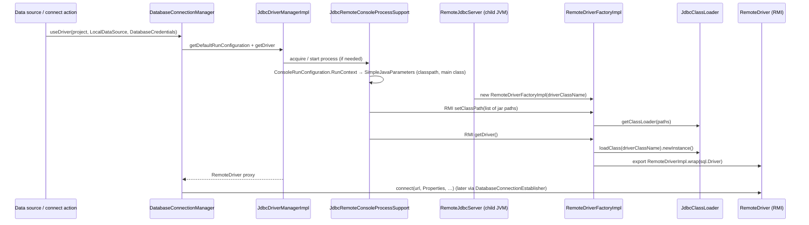
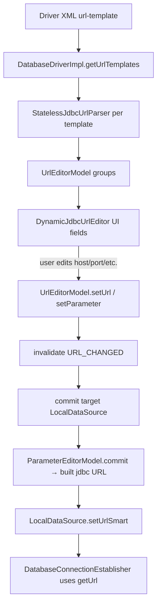
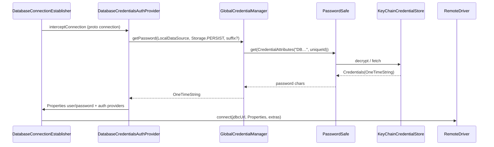
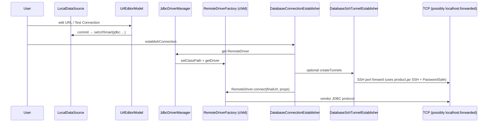

# Subsystem 2 — JDBC & database connections (deep REA/static pass)

**Target:** DataGrip 2025.x bundle (`/Applications/DataGrip.app`)  
**Primary artifacts:** `DatabaseTools` plugin JARs + platform credential JARs under `Contents/lib/`  
**Method:** `jar tf`, `strings`, `javap -c/-verbose` on bytecode; REA `inspect_managed_artifact` N/A for Java ZIP (PE-only); prior `06-jdbc-connection-contents-lib.md` merged where relevant  
**Date:** 2026-10-15

---

## Executive map — where the pipeline lives

| Layer | Path | Role in connect pipeline |
|-------|------|---------------------------|
| **Bundled driver metadata** | `Contents/plugins/DatabaseTools/lib/database-plugin.jar` | Shipped `databaseDrivers/*.xml`, `META-INF/plugin.xml` (`driversConfig`, services) |
| **Connectivity runtime** | `…/modules/intellij.database.connectivity.jar` (~4.3 MB) | Connection manager, driver manager impl, SSH tunnel, credentials façade, remote console |
| **Core models / URL / storage** | `…/modules/intellij.database.core.impl.jar` (~21 MB) | `LocalDataSource`, URL editors/parsers, `DataSourceStorage`, `DbCredentialManager` |
| **Remote JDBC child JVM** | `…/modules/intellij.database.jdbcConsole.jar` (~1.7 MB) | `RemoteJdbcServer`, `RemoteDriverFactoryImpl`, isolated `JdbcClassLoader` |
| **UI / settings shell** | `…/modules/intellij.database.impl.jar` | `DynamicJdbcUrlEditor`, `LocalDataSourceManager`, settings panels |
| **Platform secrets (lib)** | `Contents/lib/intellij.platform.ide.jar`, `intellij.platform.credentialStore.impl.jar` | `PasswordSafe`, Keychain/AES file store |

**SHA-256 (key JARs):**

| JAR | SHA-256 |
|-----|---------|
| `database-plugin.jar` | `2e646602c19d2add009f9333425b8cba05f2756d2c249936d6e43870dd2090da` |
| `intellij.database.connectivity.jar` | `2cd912e49c6726f154c9b479433630fade0ecfc9e551267e240688b31355fd7b` |
| `intellij.database.core.impl.jar` | `9688928aa5ac341d4256814c7f6e1ea4a4a689515e121ffb4050451dd2a69e10` |
| `intellij.database.jdbcConsole.jar` | `256887b4278411bdd9d146658f7650e6774c372b24a028dbd3c477f3705c34ae` |

User-visible config (inferred from `PathManager` + string constants, typical JetBrains layout):

| File / directory | Content |
|------------------|---------|
| `{config}/options/databaseDrivers.xml` | User overrides for driver definitions (`DatabaseDriverManagerImpl` `@State` name `databaseDrivers.xml`) |
| `{config}/options/dataSources.xml` | Global data sources (`dataSources.xml` constant in core) |
| `{config}/jdbc-drivers/` | Downloaded driver JARs + local artifact index (`jdbc-drivers.xml`) |
| `{project}/.idea/dataSources.xml` (or directory store) | Project-scoped sources via `DataSourceStorage$Prj` |
| `{config}/options/` (other) | IDE settings; DB passwords **not** stored here when using PasswordSafe |

Override: `-Ddatagrip.driver.path=…` → `DatabaseDriverManagerUtil.getDownloadPath()`.

---

## 1. External JDBC driver loading (isolation, storage, no IDE `DriverManager` for user drivers)

### 1.1 Architecture choice

User JDBC drivers are **not** loaded into the IDE’s application classloader for normal connections. Flow:

1. IDE builds a **classpath list** (downloaded artifacts + native libs + optional JRE).
2. Spawns or reuses a **remote JVM** (`RemoteJdbcServer`) or an **in-process** `UrlClassLoader` (fallback path in `RemoteConsoleProcessSupport`).
3. Remote side creates **`JdbcClassLoader` → `java.sql.Driver` instance → RMI `RemoteDriver` proxy**.
4. IDE calls `RemoteDriver.connect(url, Properties, …)` over RMI.

**`java.sql.DriverManager` in the IDE classpath is not the primary path** for vendor drivers; isolation is explicit.

### 1.2 Class inventory (driver loading)

| Class | JAR | Responsibility |
|-------|-----|----------------|
| `com.intellij.database.dataSource.DatabaseDriverManager` | `intellij.database.core.impl.jar` | Abstract API: list/create/update drivers |
| `com.intellij.database.dataSource.DatabaseDriverManagerImpl` | `intellij.database.connectivity.jar` | Loads bundled + user driver XML; `PersistentStateComponent<org.jdom.Element>` |
| `com.intellij.database.dataSource.DatabaseDriverImpl` | `intellij.database.connectivity.jar` | Driver entity: class name, URL templates, artifacts, VM opts |
| `com.intellij.database.dataSource.ConfigUrlBean` | (EP bean) | Points to bundled `databaseDrivers/*.xml` |
| `com.intellij.database.util.DatabaseDriverManagerUtil` | `intellij.database.core.impl.jar` | `DRIVER_DIR = "jdbc-drivers"`, `getDownloadPath()`, test XML resolution |
| `com.intellij.database.connectivity.ex.dataSource.artifacts.DatabaseArtifactLoaderImpl` | `database-plugin.jar` | Download/unpack JARs under `{config}/jdbc-drivers/` |
| `com.intellij.database.dataSource.DatabaseDriverClasspathManagerImpl` | `intellij.database.connectivity.jar` | Project/EEL-aware classpath + native lib paths |
| `com.intellij.database.dataSource.IsolateClassPathOptionProvider` | `intellij.database.core.impl.jar` | Per–data-source “isolate classpath” UI option |
| `com.intellij.database.console.JdbcDriverManager` / `JdbcDriverManagerImpl` | `intellij.database.connectivity.jar` | Per-project driver process lifecycle |
| `com.intellij.database.console.JdbcRemoteConsoleProcessSupport` | `intellij.database.connectivity.jar` | Acquire `RemoteDriverFactory`, build run config |
| `com.intellij.database.console.RemoteConsoleProcessSupport` | `intellij.database.connectivity.jar` | Classpath → remote or in-process loader |
| `com.intellij.database.run.ConsoleRunConfiguration` | `intellij.database.connectivity.jar` | VM params, env, credentials holder for child JVM |
| `com.intellij.database.remote.RemoteJdbcServer` | `intellij.database.jdbcConsole.jar` | Child `main`: export `RemoteDriverFactoryImpl` |
| `com.intellij.database.remote.jdbc.RemoteDriverFactoryImpl` | `intellij.database.jdbcConsole.jar` | `setClassPath`, lazy `getDriver()` |
| `com.intellij.database.remote.jdbc.impl.JdbcClassLoader` | `intellij.database.jdbcConsole.jar` | `URLClassLoader` + shared-class rules |
| `com.intellij.database.remote.jdbc.impl.RemoteDriverImpl` | `intellij.database.jdbcConsole.jar` | Wraps real `Driver` for RMI |
| `com.intellij.database.dataSource.DatabaseConnectionManager` | `intellij.database.connectivity.jar` | `useDriver()` → `JdbcDriverManager.getDriver()` |

### 1.3 Bundled driver definitions (classpath metadata, not JARs)

`database-plugin.jar`:

- Directory `databaseDrivers/` — per-DB XML (e.g. `h2-drivers.xml`, `postgres` in `database-drivers.xml`, etc.).
- `META-INF/plugin.xml` registers:
  - `<extensionPoint qualifiedName="com.intellij.database.driversConfig" beanClass="com.intellij.database.dataSource.ConfigUrlBean" />`
  - Many `<driversConfig config="databaseDrivers/…-drivers.xml" />`
  - `<applicationService serviceInterface="…DatabaseDriverManager" serviceImplementation="…DatabaseDriverManagerImpl" />`

Example fragment (`databaseDrivers/h2-drivers.xml`):

```xml
<driver id="h2.unified" driver-class="org.h2.Driver" dialect="H2">
  <url-template name="Remote" template="jdbc:h2:tcp://{host::localhost}[:{port::9092}]/{database::default}[;…]"/>
  <artifact id="H2" use="true" rolling="true"/>
</driver>
```

`DatabaseDriverManagerImpl` constructor:

- Flattens all `ConfigUrlBean` URLs from `CONFIG_EP` (`com.intellij.database.driversConfig`).
- Parses XML into `DatabaseDriverImpl` map (`loadState` on each).
- Calls `loadTestDrivers()` for internal `test-database-drivers.xml` when in test/internal mode.

User mutations persist to **`{options}/databaseDrivers.xml`** (component state file name constant `databaseDrivers.xml` in `DatabaseDriverManagerImpl`).

### 1.4 Downloaded driver files on disk

| Constant / API | Value / behavior |
|----------------|------------------|
| `DatabaseDriverManagerUtil.DRIVER_DIR` | `"jdbc-drivers"` |
| `DatabaseDriverManagerUtil.getDownloadPath()` | `PathManager.getConfigPath() + separator + "jdbc-drivers"` unless `datagrip.driver.path` set |
| `DatabaseArtifactLoaderImpl.DRIVER_DIR` | Same; manages artifact list `jdbc-drivers/jdbc-drivers.xml` |
| Download URLs | Embedded catalog strings in core JAR (e.g. `https://download.jetbrains.com/idea/jdbc-drivers/…`) |

Artifacts referenced by `<artifact id="…" version="…"/>` on each driver are resolved to **concrete JAR paths** via `DatabaseArtifactLoaderImpl.getClasspathElements(…)`.

### 1.5 Classloader isolation (remote JVM) — pseudocode

**IDE: `RemoteConsoleProcessSupport.acquireInProcessFactory` (in-process variant mirrors remote classpath build):**

```text
function buildRemoteOrInProcessFactory(dataSource, consoleRunConfiguration):
    params = new SimpleJavaParameters()
    runContext = createRunContext(dataSource)
    ReadAction.run { runContext.applyTo(params, consoleRunConfiguration) }

    programArgs = params.programParametersList.array  // includes driver class name for RemoteJdbcServer
    classpathPaths = params.classPath.pathList

    // In-process fallback:
    urls = map classpathPaths to Path
    loader = UrlClassLoader.build()
              .parent(getClass().getClassLoader())
              .files(urls)
              .allowLock(false)
              .get()
    return computeWithClassLoader(loader) { … spawn RemoteDriverFactory or reflect main … }
```

**Child JVM: `RemoteJdbcServer.main`:**

```text
main(args):
    SslEntityReader.setInstance(BCSslEntityReader())
    factory = new RemoteDriverFactoryImpl(args[0])  // driver class FQN
    RemoteJdbcServerBase.start(export factory)
```

**`RemoteDriverFactoryImpl.setClassPath(jarPaths)`:**

```text
function setClassPath(paths):
    assert jdbcClassLoader == null
    jdbcClassLoader = JdbcClassLoader.getClassLoader(paths)  // URLClassLoader over JAR list
```

**`RemoteDriverFactoryImpl.getDriver()`:**

```text
function getDriver():
    if driver != null: return driver
    lock()
    savedCtx = Thread.currentThread().contextClassLoader
    try:
        Thread.currentThread().contextClassLoader =
            JdbcClassLoader.createAppAndJdbcClassLoader(jdbcClassLoader)
        sqlDriver = ReflectionHelper.classForName(driverClassName, jdbcClassLoader).newInstance()
        driver = export(RemoteDriverImpl.wrap(sqlDriver, jdbcClassLoader, shouldInitLogConnectionProperties))
        return driver
    finally:
        Thread.currentThread().contextClassLoader = savedCtx
        unlock()
```

**`JdbcClassLoader.JdbcClassLoaderImpl.findClass`:**

```text
function findClass(name):
    if shareWithJdbc(name):          // selected JDK/JDBC API classes
        return appLoader.loadClass(name)
    else:
        return URLClassLoader.findClass(name)   // driver JAR
```

**IDE entry: `DatabaseConnectionManager.useDriver`:**

```text
function useDriver(project, localDataSource, databaseCredentials, consumer):
    jdbcMgr = JdbcDriverManager.getDriverManager(project)
    runCfg = jdbcMgr.getDefaultRunConfiguration(localDataSource, databaseCredentials)
    remoteDriver = jdbcMgr.getDriver(localDataSource, runCfg)
    try:
        consumer.consume(remoteDriver)
    finally:
        releaseDriver(jdbcMgr, localDataSource, runCfg)
```

### 1.6 Sequence — driver load to connect-ready



---

## 2. Connection string / URL parsing pipeline

### 2.1 Class inventory

| Class | JAR | Role |
|-------|-----|------|
| `com.intellij.database.dataSource.url.template.UrlTemplate` | core | Declarative template from driver XML `{host}`, `{port}`, `{param}` |
| `com.intellij.database.dataSource.url.StatelessJdbcUrlParser` | core | Parser interface; location types (host/port/file/…) |
| `com.intellij.database.dataSource.url.template.StatelessTemplateJdbcUrlParser` | core | Template-driven parser |
| `com.intellij.database.dataSource.url.template.TemplateJdbcUrlParser` | core | Stateful template parser |
| `com.intellij.database.dataSource.url.JdbcUrlParser` | core | Extends stateless + parameter delegate (UI/stateful) |
| `com.intellij.database.dataSource.url.JdbcUrlParserUtil` | core | Helpers, lazy parsers, simple builder |
| `com.intellij.database.dataSource.url.template.UrlEditorModelBase` | core | State machine: URL_CHANGED, VALID, invalid ranges |
| `com.intellij.database.dataSource.url.template.UrlEditorModel` | core | Multi-group editor (one group per template name) |
| `com.intellij.database.dataSource.url.template.ParameterEditorModel` | core | Single template group commit/build URL |
| `com.intellij.database.dataSource.url.ui.DynamicJdbcUrlEditor` | `intellij.database.impl.jar` | Swing UI bound to `UrlEditorModel` |
| `com.intellij.database.dataSource.DatabaseDriverImpl` | connectivity | Owns `Collection<UrlTemplate>`, `getJDBCUrlParsers()`, `matchesUrl()` |
| `com.intellij.database.dataSource.LocalDataSource` | core | Canonical stored URL; `setUrl` / `setUrlSmart`, `resolveDriver()` |

### 2.2 Data flow (UI → model → connection)



### 2.3 `UrlEditorModel` — functional pseudocode

**Construction:**

```text
function UrlEditorModel(parsers: Collection<StatelessJdbcUrlParser>):
    group parsers by parser.getName() into MultiMap
    for each groupName:
        myGroups.add(ParameterEditorModel(groupName, parsersForName))
    myGroups.add(ParameterEditorModel("URL only", empty))  // free-form URL mode
    myActive = defaultIdx  // matching parser for current URL
```

**`setUrl(raw)`:**

```text
function setUrl(raw):
    if raw == myUrl: return
    invalidate(State.URL_CHANGED)
    myUrl = raw
    // lazy re-parse on commit
```

**`commit(dataSource)`:**

```text
function commit(dataSource):
    if state == VALID and myActive == myPrevActive: return false

    changed = false
    if state == URL_CHANGED:
        if coldStart or active group changed:
            changed |= chooseGroup()           // pick parser matching URL prefix
        activeGroup.setUrl(myUrl)              // parse URL into parameters

    changed |= activeGroup.commit(dataSource) // write params + url back to model

    if myUrl != activeGroup.getUrl():
        myUrl = activeGroup.getUrl()
        changed = true

    if changed:
        notify listeners
    myPrevActive = myActive
    return changed
```

**`LocalDataSource.setUrlSmart(url)`:**

```text
function setUrlSmart(url):
    setUrl(url)
    setConfiguredByUrl(checkUrlOnly())   // true when "URL only" group active
```

**Driver auto-detection:** `DatabaseDriverImpl.matchesUrl(url)` and `LocalDataSource.resolveDriver()` (uses parser list across drivers) tie unknown URLs to a driver + dialect.

**Anonymization:** `UrlEditorModel.getAnonymizedUrl()` for logs/UI (password params stripped).

---

## 3. Credential encryption & local storage

### 3.1 No `EncryptableMap` in shipped tree

Static search across `Contents/lib` and DatabaseTools modules found **no** `EncryptableMap` class. DB passwords use **`PasswordSafe` + `CredentialAttributes`**, not cleartext maps in XML.

### 3.2 Class inventory

| Class | JAR | Role |
|-------|-----|------|
| `com.intellij.database.access.DbCredentialManager` | `intellij.database.core.impl.jar` | `getPassword` / `setPassword` for `LocalDataSource` |
| `com.intellij.database.access.GlobalCredentialManager` | `intellij.database.connectivity.jar` | Singleton; `getPasswordSafe()` |
| `com.intellij.database.access.GlobalStrictCredentialManager` | connectivity | Stricter variant (same package) |
| `com.intellij.database.access.DatabaseCredentials` / `DatabaseCredentialsImpl` | core / connectivity | Session credential bundle for connect |
| `com.intellij.database.dataSource.DatabaseCredentialsAuthProvider` | connectivity | Interceptor: apply/ask credentials on connect |
| `com.intellij.database.dataSource.LocalDataSource$Storage` | core | `PERSIST`, `MEMORY`, `SESSION`, `NO` |
| `com.intellij.ide.passwordSafe.PasswordSafe` | `intellij.platform.ide.jar` | Facade get/set |
| `com.intellij.credentialStore.CredentialAttributes` | platform ide | Service name + user name keys |
| `com.intellij.credentialStore.CredentialAttributesKt.generateServiceName` | platform ide | `"subsystem" + key` concatenation |
| `com.intellij.credentialStore.KeyChainCredentialStore` | `intellij.platform.credentialStore.impl.jar` | **macOS Keychain** |
| `com.intellij.credentialStore.AesEncryptionSupport` | credentialStore.impl | **File store AES** (master password) |
| `com.intellij.credentialStore.SecretCredentialStore` | credentialStore.impl | Linux Secret Service |
| `com.intellij.credentialStore.KWalletCredentialStore` | credentialStore.impl | KDE Wallet |
| `com.intellij.database.dataSource.LocalDataSourceSerialization` | core | XStream XML for DS settings (**password not in XML**) |

### 3.3 Password key derivation (observed bytecode)

```text
function createCredentialAttributes(dataSource, suffix: String?):
    // Phase 2b javap (DbCredentialManager) — prefer over earlier inference:
    subsystem = "DB"
    key = (suffix ?: "") + dataSource.getUniqueId()
    serviceName = CredentialAttributesKt.generateServiceName(subsystem, key)
    // => "IntelliJ Platform DB — " + key
    return CredentialAttributes(serviceName)  // default copy flags
```

`generateServiceName` recipe (platform JAR): `"IntelliJ Platform " + subsystem + " — " + key`. See [12-dynamic-validation-2b.md](./12-dynamic-validation-2b.md) §5.

### 3.4 Get / set pseudocode

```text
function getPassword(dataSource, storage: LocalDataSource$Storage, suffix):
    if storage.isOneTime(): return null
    attrs = createCredentialAttributes(dataSource, suffix)
    creds = PasswordSafe.getInstance().get(attrs)
    return creds?.getPassword()  // OneTimeString (char[], cleared after use)

function setPassword(dataSource, password: OneTimeString?, storage, suffix):
    attrs = createCredentialAttributes(dataSource, suffix)
    memoryOnly = storage.isOneTime()
    if password != null && !memoryOnly:
        creds = new Credentials(userName=null, password)
    else:
        creds = null
    persistFlag = storage.isPersisted()
    PasswordSafe.getInstance().set(attrs, creds, /* requester memoryOnly */ !persistFlag)
```

**`LocalDataSource$Storage` semantics:**

| Enum | `isPersisted()` | `isOneTime()` | Behavior |
|------|-----------------|---------------|----------|
| `PERSIST` | true | false | Keychain/file via PasswordSafe |
| `MEMORY` | false | false | Session memory in PasswordSafe |
| `SESSION` | … | … | Session-scoped (serialize as mode string) |
| `NO` | … | true | Do not store; ask each time |

User name is stored **in data source XML** (`username` attribute via `LocalDataSourceSerialization`); **password is external** to `dataSources.xml`.

### 3.5 Platform encryption (Contents/lib — from report 06)

See `06-jdbc-connection-contents-lib.md` for full platform stack. Summary:

- **macOS:** `KeyChainCredentialStore` → Keychain item per `CredentialAttributes.serviceName`.
- **Fallback file store:** `AesEncryptionSupport` with master key (IDE “master password” flow).
- **Windows:** `WindowsCrypt32EncryptionSupport` (DPAPI-assisted).
- Optional **PGP** wrapper for advanced setups.

SSH tunnel passwords reuse the same `PasswordSafe` stack via `product.jar` SSH helpers (also documented in report 06).

### 3.6 Persistence XML (what is stored where)

| Store | File / component | Contains |
|-------|------------------|----------|
| Global DS | `{config}/options/dataSources.xml` | URLs, usernames, driver refs, SSH/SSL blocks, `password-storage` mode — **not** cleartext password |
| Project DS | `.idea/dataSources.xml` or directory-based project store | Same schema, project scope |
| Drivers | `{config}/options/databaseDrivers.xml` | Custom driver defs, artifact refs, VM options |
| Download index | `{config}/jdbc-drivers/jdbc-drivers.xml` | Cached artifact metadata |
| Secrets | OS Keychain / `{config}/c.kdbx` (or platform-specific) | Password material via PasswordSafe |

`DataSourceModelStorageImpl` (connectivity) loads/saves introspection **models** to separate files under project/system caches — not the JDBC secret store.

### 3.7 Sequence — connect with credentials



---

## 4. End-to-end connect sequence (merged)



---

## 5. `Contents/lib/` boundary (Subsystem 2 vs platform)

Full JDBC orchestration is **not** in `Contents/lib/` (see `06-jdbc-connection-contents-lib.md`). Lib still provides:

- **Credential at-rest crypto** (`intellij.platform.credentialStore.impl.jar`)
- **SSH transport** (`product.jar`) for tunneled JDBC
- **Post-connect error DTOs** (`intellij.grid.core.impl.jar`)

---

## 6. REA / tooling notes

| Tool | Result |
|------|--------|
| `inspect_managed_artifact` on `.jar` | Unsupported (PE-only provider) |
| `inspect_managed_members` | .NET PE only — use `javap` for Java |
| `project_managed_application_graph` | Requires prior Evidence IDs — not used this pass |

Recommended follow-up: JEB/Fernflower on `DatabaseConnectionEstablisher`, `ConsoleRunConfiguration$RunContext`, `DatabaseArtifactLoaderImpl.downloadArtifact` for exact classpath ordering and SSL property injection.

---

## 7. Related reports

- `00-overview.md` — bundle layout  
- `05-database-plugin-jar.md` — plugin shell inventory  
- `06-jdbc-connection-contents-lib.md` — PasswordSafe + SSH in `Contents/lib/` only  

---

*Analysis pass complete for Subsystem 2 (JDBC & connections).*
