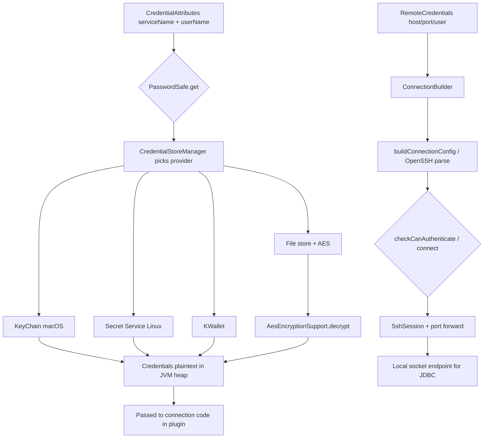

# JDBC / connection subsystem — `Contents/lib/` only (REA)

**Scope:** `/Applications/DataGrip.app/Contents/lib/`  
**Method:** REA `open_binary` + `inspect_artifact` on JARs; ZIP entry scan; `javap` on bytecode (REA has no JVM decompiler without JEB/JADX).  
**Date:** 2026-10-14

---

## 0. Scope finding (important)

REA inventory + class-path scan of **all** `Contents/lib/*.jar` shows:

| Expected JDBC/connect component | Present in `Contents/lib`? |
|--------------------------------|----------------------------|
| `DatabaseConnectionManager` | **No** (plugin: `intellij.database.connectivity.jar`) |
| `DatabaseDriverManagerImpl` / driver classpath | **No** (same plugin) |
| `JdbcDriverManager` / `JdbcEngine` | **No** (same plugin) |
| `DriverManager.getConnection` call chain | **No** in lib |
| URL / data source model parsing | **No** in lib |

**Conclusion:** Full “user URL → driver classloader → JDBC socket” pipeline is **not shipped in `Contents/lib`**. It lives under `Contents/plugins/DatabaseTools/`.  

Within **`Contents/lib`**, REA finds only **supporting** pieces: **credential storage/encryption**, **SSH tunnel to socket**, **post-connect error DTOs**, and **remote JDBC value wrappers** for the data grid.

---

## 1. Core classes in `Contents/lib` (connection-related)

### 1.1 Database credentials (at rest)

| Class | JAR | Role |
|-------|-----|------|
| `com.intellij.ide.passwordSafe.PasswordSafe` | `intellij.platform.ide.jar` | Facade: get/set passwords by `CredentialAttributes` |
| `com.intellij.credentialStore.CredentialStoreManager` / `Impl` | `intellij.platform.ide.jar` | OS provider selection (Keychain, Secret Service, KWallet, file) |
| `com.intellij.credentialStore.CredentialAttributes` | `intellij.platform.ide.jar` | Key: `serviceName`, `userName`, memory-only flags |
| `com.intellij.credentialStore.Credentials` | `intellij.platform.ide.jar` | User + password payload |
| `com.intellij.credentialStore.EncryptionSupport` | `intellij.platform.credentialStore.impl.jar` | Interface: `encrypt` / `decrypt` |
| `com.intellij.credentialStore.AesEncryptionSupport` | `intellij.platform.credentialStore.impl.jar` | AES with master `Key` |
| `com.intellij.credentialStore.WindowsCrypt32EncryptionSupport` | same | Windows DPAPI-backed AES |
| `com.intellij.credentialStore.PgpKeyEncryptionSupport` | same | Optional PGP layer |
| `com.intellij.credentialStore.KeyChainCredentialStore` | same | macOS Keychain |
| `com.intellij.credentialStore.SecretCredentialStore` | same | Linux libsecret |
| `com.intellij.credentialStore.KWalletCredentialStore` | same | KDE Wallet |
| `com.intellij.credentialStore.PasswordSafeSettings` | same | Remember-password defaults |

**REA:** `intellij.platform.credentialStore.impl.jar` — SHA `c5121140…`, **312** ZIP entries (`inspect_artifact` summary).

DB passwords are stored under attributes whose `serviceName` is defined by the database plugin (not in lib); lib only implements **how** secrets are encrypted and retrieved.

### 1.2 Transport to socket (SSH tunnel path)

| Class | JAR | Role |
|-------|-----|------|
| `com.intellij.ssh.ConnectionBuilder` | `product.jar` | Build SSH session → TCP to remote host:port |
| `com.intellij.ssh.RemoteCredentialsUtil` | `product.jar` | Map `RemoteCredentials` → `ConnectionBuilder` |
| `com.intellij.ssh.SshConnectionService` | `product.jar` | Session lifecycle |
| `com.intellij.ssh.config.SshConnectionConfig` | `product.jar` | Host, user, keys, proxy, OpenSSH config |
| `com.intellij.ssh.config.RemoteCredentialsSshConnectionConfig` | `product.jar` | Bridge remote IDE/DB SSH settings |

Used when a data source uses **SSH/SSL tunnel**; JDBC driver then connects to `localhost:forwardedPort` (driver code is outside lib).

### 1.3 Not connection init (do not confuse)

| Location | Purpose |
|----------|---------|
| `intellij.grid.core.impl.jar` → `com.intellij.database.connection.throwable.info.*` | UI error/fix hints after failed connect |
| `intellij.grid.types.jar` → `com.intellij.database.remote.jdbc.*` | LOB/geo DTOs over existing JDBC session |
| `intellij.libraries.mvstore.jar` → `org.h2.jdbc.*` | Embedded H2 for IDE storage, not user DB connect |

---

## 2. Data flow (within what `Contents/lib` can implement)

```mermaid
sequenceDiagram
  participant UI as Data source UI (plugin, out of lib)
  participant PS as PasswordSafe (lib/ide.jar)
  participant CS as CredentialStore impl (lib/credentialStore.impl.jar)
  participant OS as OS Keychain / Secret Service
  participant RC as RemoteCredentials (plugin API)
  participant CB as ConnectionBuilder (lib/product.jar)
  participant SSH as SSH backend (lib/product.jar)
  participant SOCK as TCP socket
  participant JDBC as JDBC driver (plugin + driver JAR)

  Note over UI,JDBC: Stages inside Contents/lib shaded

  UI->>PS: get(CredentialAttributes for DB password)
  PS->>CS: get(attributes)
  CS->>OS: unlock / read secret
  OS-->>CS: encrypted blob
  CS->>CS: decrypt (AES / platform)
  CS-->>PS: Credentials(user, password)
  PS-->>UI: password in memory

  alt SSH tunnel configured
    UI->>RC: host, user, key, port
    RC->>CB: RemoteCredentialsUtil.connectionBuilder()
    CB->>SSH: connect(timeout)
    SSH->>SOCK: TCP to remote DB port (tunneled)
    Note over SOCK,JDBC: Plugin opens JDBC to localhost:localPort
  else Direct JDBC
    Note over CB,JDBC: No lib classes; plugin only
  end

  JDBC->>SOCK: Driver protocol (outside lib)
```

**Parsing / validation of JDBC URL, driver class, SSL params:** not in `Contents/lib` (plugin `DatabaseDriverImpl`, `DataSourceModelStorageImpl`, etc.).

---

## 3. Parameter & credential flow (lib layers only)



---

## 4. Pseudocode — primary init available in `Contents/lib`

### 4.1 Credential retrieval (`PasswordSafe` + stores)

*Derived from public API + `SecretCredentialStore.get` / `AesEncryptionSupport` bytecode.*

```text
function PasswordSafe_get(attributes: CredentialAttributes) -> Credentials?:
    store := CredentialStoreManagerImpl.defaultProvider() // Keychain | Secret | file
    return store.get(attributes)

function SecretCredentialStore_get(attributes):
    try:
        return supplyAsync(() -> nativeReadSecret(attributes), timeout=30s)
    catch TimeoutException:
        log.warn("storage unlock timeout")
        return CANNOT_UNLOCK_KEYCHAIN sentinel

function AesEncryptionSupport_decrypt(ciphertext: bytes) -> bytes:
    // Master key from OS-protected master key file / Keychain
    return AES_decrypt(masterKey, ciphertext)

function PasswordSafe_set(attributes, credentials, memoryOnly):
    if memoryOnly or attributes.isPasswordMemoryOnly:
        keep in session memory only
    else:
        store.set(attributes, credentials)  // encrypt via EncryptionSupport first on file backend
```

**Security patterns (observed in lib):**

- **At rest:** macOS Keychain / Linux Secret Service / KWallet, or **AES** file store (`AesEncryptionSupport`, `WindowsCrypt32EncryptionSupport`).
- **Optional PGP** wrapper (`PgpKeyEncryptionSupport`).
- **Memory-only** passwords (`CredentialAttributes.isPasswordMemoryOnly`, `PasswordSafe.isMemoryOnly`) — skip persistent store.
- **Sentinels** for denied Keychain access (`ACCESS_TO_KEY_CHAIN_DENIED`, `CANNOT_UNLOCK_KEYCHAIN`).
- **No JDBC URL or driver secrets logic in lib** — only generic `(serviceName, username) → password`.

### 4.2 SSH tunnel init (`RemoteCredentialsUtil` + `ConnectionBuilder`)

*From `RemoteCredentialsUtil.connectionBuilder` bytecode.*

```text
function RemoteCredentialsUtil_connectionBuilder(remote: RemoteCredentials, ...) -> ConnectionBuilder:
    host := remote.getHost()  // required
    builder := new ConnectionBuilder(host)
    builder.withSshPasswordProvider(PlatformSshPasswordProvider(remote, promptUI))
    builder.withProgressIndicator(indicator)
    builder.withSshConnectionConfig(lambda config: applyRemoteCredentials(config, remote))
    builder.withParsingOpenSSHConfig(remote.shouldUseOpenSshConfig())
    return builder

function ConnectionBuilder_connect(timeout) -> SshSession:
    config := buildConnectionConfig()      // keys, proxy, ciphers from OpenSSH + remote settings
    sessionConfig := buildSessionConfig()
    return sshBackend.connect(sessionConfig, timeout)  // TCP + auth → SshSession
    // Port forwarding for DB is configured in plugin layer after session exists
```

**Security patterns:**

- Password/key from **PasswordSafe** or interactive `SshPasswordProvider`.
- **OpenSSH config** parsing optional (`withParsingOpenSSHConfig`).
- Timeouts on connect and Keychain unlock.

### 4.3 What is *not* in lib (reference only — do not analyze here)

Plugin class **`DatabaseConnectionManager`** (not in scope path) orchestrates: resolve driver → build JDBC URL → apply credentials from §4.1 → optional SSH local port from §4.2 → `Driver.connect` / pool.

---

## 5. REA artifacts (this pass)

| Target | SHA-256 (short) | REA op |
|--------|-----------------|--------|
| `intellij.platform.credentialStore.impl.jar` | `c5121140…` | `open_binary`, `inspect_artifact` |
| `product.jar` | `fbb3f1c3…` | `open_binary` |

---

## 6. Next step if you need full JDBC trace

Re-run same REA/JEB pass on **`Contents/plugins/DatabaseTools/lib/modules/intellij.database.connectivity.jar`** (`DatabaseConnectionManager`, `DatabaseDriverManagerImpl`) — required for driver loading and URL validation. That is outside the directory you specified.
