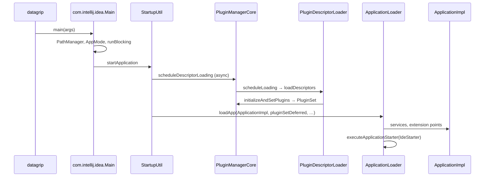
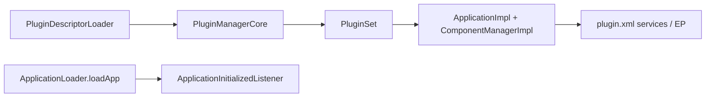

# Subsystem 1 — Core Architecture & Lifecycle

**Build:** DataGrip 2026.1.3 (`DB-261.24374.56`) · **Path:** `/Applications/DataGrip.app`  
**Methods:** `product-info.json`, JAR index, Vineflower decompile, launcher strings. REA MCP unavailable in source session.  
**Related:** [00-overview.md](./00-overview.md), [02-native-launcher.md](./02-native-launcher.md), [01-app-inventory.md](./01-app-inventory.md)

---

## 0. Product identity & runtime envelope

| Field | Value |
|--------|--------|
| Bundle ID | `com.jetbrains.datagrip` |
| Native launcher | `Contents/MacOS/datagrip` (`xplat_launcher`, arm64) |
| JVM | JBR **25.0.2+10-b329.117-jcef** → `Contents/jbr/Contents/Home/bin/java` |
| Config | `-Didea.paths.selector=DataGrip2026.1` |
| Prefix | `-Didea.platform.prefix=DataGrip` |
| Module graph | `-Dintellij.platform.runtime.repository.path=…/modules/module-descriptors.dat` |
| `Contents/lib/` | 364 JARs; **203** on initial boot classpath |

---

## 1. Entry points & bootstrapping JARs

### 1.1 Launch descriptor (`Contents/Resources/product-info.json`)

- **`mainClass`:** `com.intellij.idea.Main` → **`app.jar`**
- **`bootClassPathJarNames`:** 203 JARs under `Contents/lib/`

**Bootstrap head (order matters):**

| # | JAR | Role |
|---|-----|------|
| 1 | `platform-loader.jar` | `PathClassLoader`, `RuntimeModuleRepository`, `IntellijLoader` |
| 2 | `util-8.jar` | Early log4j + `com.intellij.diagnostic.LoadingState` |
| 3 | `app.jar` | `Main`, `ModularMain`, `ModuleBasedProductLoadingStrategy` |
| 4 | `util.jar` | `ComponentManager` API |
| … | libraries / platform JARs | Coroutines, IO, UI stack |
| tail | `product.jar`, `util_rt.jar`, … | **`META-INF/plugin.xml` (IDEA CORE)**, RT utils |

**Critical flags (from `additionalJvmArguments`):**

```text
-Xbootclasspath/a:…/nio-fs.jar
-Djava.system.class.loader=com.intellij.util.lang.PathClassLoader
-Didea.platform.prefix=DataGrip
-Dintellij.platform.runtime.repository.path=…/modules/module-descriptors.dat
-Djava.nio.file.spi.DefaultFileSystemProvider=com.intellij.platform.core.nio.fs.MultiRoutingFileSystemProvider
```

Alternate command `stdioMcpServer` → `com.intellij.mcpserver.stdio.McpStdioRunnerKt`.

### 1.2 Native launcher → JVM

```text
function datagrip_native_main(argv):
 product = parse(Resources/product-info.json)
 java = resolve_jbr(bundled → env)
 vmOptions = datagrip.vmoptions + user overrides
 classPath = join(product.bootClassPathJarNames → Contents/lib/*.jar)
 CreateJavaVM(-Djava.class.path=…, additionalJvmArguments…)
 invoke com.intellij.idea.Main.main(argv)
 CoreFoundation event loop (macOS)
```

### 1.3 Two Java bootstrap modes

**Mode A — packaged `.app` (authoritative for DataGrip):**

- Entry: **`com.intellij.idea.Main`**
- Full **203-JAR** classpath from native launcher
- System CL: **`com.intellij.util.lang.PathClassLoader`**

**Mode B — modular bootstrap (platform infrastructure):**

- Entry: **`com.intellij.platform.runtime.loader.IntellijLoader`** (`platform-loader.jar`)

```java
// IntellijLoader → ModularMain → Main.mainImpl
RuntimeModuleRepository repo = RuntimeModuleRepository.create(
 Path.of(System.getProperty("intellij.platform.runtime.repository.path")));
List<Path> extra = repo.getBootstrapClasspath("intellij.platform.bootstrap");
((PathClassLoader) getClassLoader()).getClassPath().addFiles(extra);
ModularMain.main(repo, args, timings, startUnixNano);
```

```java
// ModularMain (app.jar)
ModuleBasedProductLoadingStrategy s = new ModuleBasedProductLoadingStrategy(repo);
ProductLoadingStrategy.Companion.setStrategy(s);
Main.mainImpl(args, timings, startUnixNano, s::addMainModuleGroupToClassPath);
```

macOS product-info uses **Mode A**; Mode B expands classpath from `module-descriptors.dat`.

### 1.4 `PathClassLoader` (`platform-loader.jar`)

- `-Djava.system.class.loader=com.intellij.util.lang.PathClassLoader`
- `addFiles` / `reset`; optional bytecode `BytecodeTransformer`
- Manifest `Class-Path` expansion via `idea.reset.classpath.from.manifest`

---

## 2. IDE initialization pipeline

### 2.1 Sequence (normal GUI)



### 2.2 `com.intellij.idea.Main` (`app.jar`)

| Method | Role |
|--------|------|
| `main` | Timings → `mainImpl(..., changeClassPath=null)` |
| `mainImpl` | `PathManager`, `runBlocking` |
| `startApp` | Span `"startApplication"` → **`StartupUtil.startApplication`** |

```kotlin
fun mainImpl(rawArgs, timings, startUnixNano, changeClassPath: Consumer<ClassLoader>?) {
 val args = preprocessArgs(rawArgs)
 AppMode.setFlags(args)
 PathManager.loadProperties(); PathManager.customizePaths(args)
 runBlocking { startApp(args, scope, busyThread, changeClassPath) }
}
```

### 2.3 `StartupUtil` (`intellij.platform.lang.impl.jar`)

**Class:** `com.intellij.platform.ide.bootstrap.StartupUtil`  
(Legacy `com.intellij.idea.StartupUtil` in `intellij.platform.builtInServer.impl.jar` — not used by `Main`.)

Parallel work in `startApplication`:

| Job | Purpose |
|-----|---------|
| `lockSystemDirsJob` | Config/system lock, import |
| `initAwtToolkitJob` / `initLafJob` | UI (headful) |
| `pluginSetDeferred` | **`PluginManagerCore.scheduleDescriptorLoading`** |
| `appLoaded` | **`ApplicationLoader.loadApp`** |
| `configImportDeferred` | Settings import gate |

### 2.4 Plugin registry

**Not in this build:** `IdeaApplicationLoader`, `PluginListLoader`, `IdeaApplication` → use **`ApplicationLoader`**, **`PluginDescriptorLoader`**.

| Class | JAR |
|-------|-----|
| `PluginDescriptorLoader` | `intellij.platform.core.impl.jar` |
| `PluginManagerCore` | `intellij.platform.core.impl.jar` |
| `PathBasedProductLoadingStrategy` | `intellij.platform.core.impl.jar` |
| `ModuleBasedProductLoadingStrategy` | `app.jar` |

**`PluginManagerCore`:**

- `CORE_ID` = `com.intellij`
- `scheduleDescriptorLoading` → idempotent `PluginDescriptorLoader.scheduleLoading`
- `initializeAndSetPlugins` → span `"plugin initialization"`
- `buildPluginIdMap()` after **`LoadingState.COMPONENTS_REGISTERED`** (`util-8.jar`)

**`PluginDescriptorLoader.scheduleLoading`:**

```kotlin
scope.async {
 val (ctx, discovered) = loadDescriptors(zipPool, mainClassLoader)
 initializeAndSetPlugins(errors, initContext, discovered) // → PluginSet
}
```

**`ModuleBasedProductLoadingStrategy`** (ModularMain path):

- `addMainModuleGroupToClassPath` — EMBEDDED runtime modules → `PathClassLoader`
- `loadPluginDescriptors` — core (prefix **`DataGrip`**) + custom dir + bundled modules
- Needs `intellij.platform.root.module`, reads `META-INF/{root}/product-modules.xml`

**`PathBasedProductLoadingStrategy`** — typical full-classpath `.app` launch.

### 2.5 DataGrip product layout

`product-info.json` **layout:** 716 entries (345 `productModuleV2`, 279 `moduleV2`, 40 plugins).

| Module | JARs |
|--------|------|
| `com.intellij.database` | `plugins/DatabaseTools/lib/database-plugin.jar` |
| `com.intellij.database.ide` | `plugins/datagrip-impl/lib/datagrip-impl.jar` |

**`product.jar`:** IDEA CORE `META-INF/plugin.xml`, `com.intellij.modules.datagrip`, `idea/DataGripApplicationInfo.xml` (essential: `com.intellij.database`, `com.intellij.database.ide`).

**`datagrip-impl.jar`:** id `com.intellij.database.ide` — DG UI/project overrides.

---

## 3. Application & component manager

| Type | JAR | FQN |
|------|-----|-----|
| Component API | `util.jar` | `com.intellij.openapi.components.ComponentManager` |
| Application impl | `intellij.platform.ide.impl.jar` | `com.intellij.openapi.application.impl.ApplicationImpl` |
| DI impl | `intellij.platform.ide.jar` | `com.intellij.serviceContainer.ComponentManagerImpl` |
| Bootstrap | `intellij.platform.lang.impl.jar` | `com.intellij.platform.ide.bootstrap.ApplicationLoader` |

**`ApplicationLoader`:**

| Phase | Function |
|-------|----------|
| Shell | `initApplication` → `appRegistered.complete()` |
| Load | `loadApp` — await `pluginSetDeferred`, register EP/services |
| Config | `initConfigurationStore` |
| Starter | `createDefaultAppStarter()` → **`IdeStarter`** (DataGrip prefix ≠ LightEdit) |
| Run | `executeApplicationStarter` |
| Post | `applicationInitializedListener` EP (non-core restricted) |



---

## 4. End-to-end mental model

```text
datagrip → 203 JAR classpath → PathClassLoader → Main
 → StartupUtil (parallel: dirs, AWT, plugins, log)
 → PluginDescriptorLoader + ProductLoadingStrategy
 → ApplicationLoader → ApplicationImpl
 → IdeStarter → DG shell (product.jar + datagrip-impl + database-plugin)
```

Modular fork: `IntellijLoader` → repo from `module-descriptors.dat` → `ModularMain` → same `Main.mainImpl` with classpath hook.

---

## 5. Evidence

- Decompile: Vineflower 1.11.1 → `/Users/hema/Desktop/Experiments/Grip/tmp/decompiled*`
- Index: `/Users/hema/Desktop/Experiments/Grip/tmp/jar-index.txt`
- REA MCP: connection error in source session

### 5.1 Lifecycle class → JAR map (from `jar-index.txt`)

| Class | JAR |
|-------|-----|
| `com.intellij.idea.Main` | `app.jar` |
| `com.intellij.platform.bootstrap.ModularMain` | `app.jar` |
| `com.intellij.platform.runtime.loader.IntellijLoader` | `platform-loader.jar` |
| `com.intellij.util.lang.PathClassLoader` | `platform-loader.jar` |
| `com.intellij.platform.ide.bootstrap.StartupUtil` | `intellij.platform.lang.impl.jar` |
| `com.intellij.platform.ide.bootstrap.ApplicationLoader` | `intellij.platform.lang.impl.jar` |
| `com.intellij.ide.plugins.PluginDescriptorLoader` | `intellij.platform.core.impl.jar` |
| `com.intellij.ide.plugins.PluginManagerCore` | `intellij.platform.core.impl.jar` |
| `com.intellij.openapi.components.ComponentManager` | `util.jar` |
| `com.intellij.openapi.application.impl.ApplicationImpl` | `intellij.platform.ide.impl.jar` |
| `com.intellij.serviceContainer.ComponentManagerImpl` | `intellij.platform.ide.jar` |

Note: `com.intellij.idea.StartupUtil` also exists in `intellij.platform.builtInServer.impl.jar` but is not the bootstrap class wired from `Main`.
