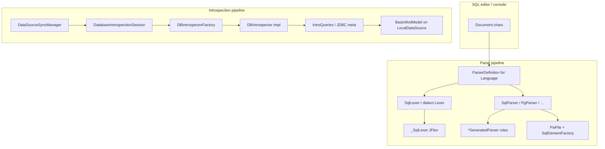
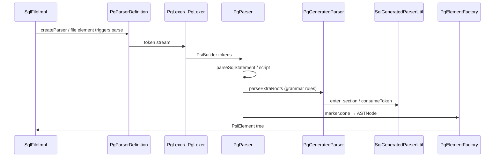
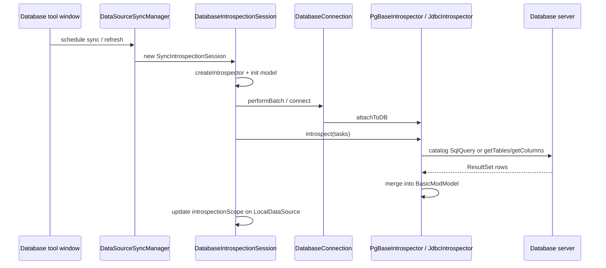

# Subsystem 3 — Query Parsing & Schema Introspection

**Build:** DataGrip 2026.1.3 (`DB-261.24374.56`)  
**Primary paths:** `Contents/plugins/DatabaseTools/lib/database-plugin.jar`, `Contents/plugins/DatabaseTools/lib/modules/*.jar`  
**Platform PSI:** `Contents/lib/intellij.platform.analysis.impl.jar` (`com.intellij.lang.parser.GeneratedParserUtilBase`)  
**Methods:** JAR entry scan, `META-INF/plugin.xml` extraction, Vineflower decompile (JBR 25 + `tmp/vineflower.jar`). Class lookup: `tmp/jar-index-database-modules.txt` (DatabaseTools modules) + `tmp/jar-index.txt` (platform `Contents/lib/`). REA `open_binary` on `database-plugin.jar`; REA Java decompile unavailable (MCP discovery error on managed tools).  
**Related:** [00-overview.md](./00-overview.md), [05-database-plugin-jar.md](./05-database-plugin-jar.md), [07-core-architecture-lifecycle.md](./07-core-architecture-lifecycle.md), [06-jdbc-connection-contents-lib.md](./06-jdbc-connection-contents-lib.md)

---

## 0. Executive map

DataGrip SQL understanding is **not** in `Contents/lib/` except generic IntelliJ Platform language infrastructure. All SQL grammar, dialect PSI, and schema introspection live in the **DatabaseTools** plugin:

| Layer | Responsibility | Typical packages |
|--------|----------------|------------------|
| **Lexer (JFlex → Java)** | Tokenize SQL text, states for comments/qualification/vars | `com.intellij.sql.dialects.base._SqlLexer`, `*._BigQueryLexer`, … |
| **Parser (Grammar-Kit → Java)** | LL/recursive-descent via `PsiBuilder`, build AST markers | `*GeneratedParser`, `SqlParser` / `PgParser` subclasses |
| **PSI** | AST → `PsiElement`, stubs, references | `com.intellij.sql.psi.*`, `com.intellij.sql.dialects.*.psi` |
| **Dialect binding** | Map `Dbms` ↔ language ↔ parser/lexer | EP `com.intellij.sql.dialect`, `lang.parserDefinition` |
| **Introspection** | Populate `BasicModModel` from DB | `DBIntrospector`, `*Introspector`, `*IntroQueries`, JDBC fallback |
| **Orchestration** | When/how introspection runs | `DatabaseIntrospectionSession`, `DataSourceSyncManager` |



---

## 1. JAR module inventory (parsing & introspection)

### 1.1 Fat plugin vs split modules

| Artifact | ~Size | Role |
|----------|-------|------|
| `DatabaseTools/lib/database-plugin.jar` | ~46 MB | **Monolith**: most dialect `*Parser`/`*Lexer`/`*GeneratedParser`, many `*Introspector`, `META-INF/plugin.xml` (~357 KB) |
| `DatabaseTools/lib/modules/intellij.database.dialects.base.jar` | split | **Shared SQL base**: `SqlParser`, `SqlLexer`, `_SqlLexer`, `SqlGeneratedParser`, `SqlParserDefinitionBase`, JDBC introspection base |
| `intellij.database.dialects.base.ex.jar` | split | Extended base / shared extras |
| `intellij.database.dialects.postgres.jar` | split | `PgParserDefinition`, `PgParser`, `PgLexer`, `PgGeneratedParser` |
| `intellij.database.dialects.postgresbase.jar` | split | `PgBaseIntrospector`, `PgBaseIntroQueries`, PG catalog SQL |
| `intellij.database.dialects.mysql.jar`, `mysqlbase*.jar`, `mssql*.jar`, … | split | Dialect-specific modules (lazy classpath) |
| `intellij.database.sql.jar` | split | `SqlLanguageDialect`, bundles, file types |
| `intellij.database.sql.core.impl.jar` | split | `SqlPsiFacadeImpl`, PSI impl, formatter hooks |
| `intellij.database.sql.common.core.jar` / `*.impl.jar` | split | Shared SQL PSI types, injection |
| `intellij.database.core.impl.jar` | split | `DBIntrospector` API, `IntrospectionTasks`, task types |
| `intellij.database.connectivity.jar` | split | `DatabaseIntrospectionSession`, connection batching |
| `intellij.database.impl.jar` | split | UI/services wiring, sync manager hooks |
| `intellij.database.jdbcConsole.jar` | split | Console execution (pairs with parsing for injection) |

**Counts inside `database-plugin.jar` (static scan):**

- `*GeneratedParser.class`: **16**
- `*ParserDefinition.class`: **20**
- Dialect-named Parser/Lexer triples (sample pattern): **9+** families embedded in monolith (BigQuery, Cassandra, ClickHouse, Cockroach, …)

Dialect parsers also appear in module JARs (e.g. `intellij.database.dialects.mongo.sql.jar` contains `SqlLexer` for Mongo SQL surface).

### 1.2 Platform dependencies (boot classpath)

| Class / API | JAR under `Contents/lib/` |
|-------------|---------------------------|
| `com.intellij.lang.ParserDefinition` | `intellij.platform.lang.jar` (API) |
| `com.intellij.lang.parser.GeneratedParserUtilBase` | **`intellij.platform.analysis.impl.jar`** |
| `com.intellij.lang.PsiBuilder` | platform lang impl |
| `com.intellij.lexer.FlexAdapter`, `LookAheadLexer` | platform lexer |
| `com.intellij.psi.stubs.*` | stub index support |

SQL code **extends** platform `GeneratedParserUtilBase` via `com.intellij.sql.dialects.base.SqlGeneratedParserUtil`.

---

## 2. Extension points & registration (`META-INF/plugin.xml`)

Extracted from `database-plugin.jar` (representative):

| EP / extension | FQCN / attribute | Purpose |
|----------------|------------------|---------|
| `com.intellij.sql.dialect` | `SqlLanguageDialect` impl | Editor language, keywords, parser routing |
| `com.intellij.database.dialect` | `DatabaseDialect` impl | DBMS semantics (types, CTE, introspection triggers) |
| `com.intellij.database.introspector` | `DBIntrospector.Factory` | Native vs generic introspector per `Dbms` |
| `com.intellij.database.jdbcSourceLoader` | `JdbcSourceLoader` | DDL/source text via JDBC when enabled |
| `com.intellij.database.jdbcMetadataWrapper` | `DatabaseMetaDataWrapper.MDFactory` | Per-DBMS metadata quirks |
| `lang.parserDefinition` | `*ParserDefinition` | **38** language entries (SQL, PostgreSQL, MySQL, …) |
| `lang.parserDefinition language="SQL"` | `com.intellij.sql.dialects.base.SqlParserDefinitionBase$Sql` | Generic SQL file stub (lexer/parser throw — dialect resolves) |
| `lang.ast.factory language="SQL"` | `com.intellij.sql.dialects.base.SqlASTFactory` | AST node factory |
| Topic `DatabaseModelLoader.TOPIC` | listeners e.g. `DbFusIntrospectionLogger` | Telemetry on introspection start/finish |

**Dual dialect interfaces:**

```java
// com.intellij.database.dialects.DatabaseDialect
public interface DatabaseDialect {
   DbmsExtension<DatabaseDialect> EP = new DbmsExtension<>("com.intellij.database.dialect");
   Dbms getDbms();
   boolean triggersIntrospection(@NotNull PsiElement element);
   // typing, CTE, INSERT, table info, …
}
```

```kotlin
// com.intellij.database.introspection.DBIntrospectorFactory — INTRO_EP
internal val INTRO_EP: DbmsExtension<Factory> = DbmsExtension("com.intellij.database.introspector")
```

---

## 3. SQL lexer architecture (Grammar-Kit / JFlex)

### 3.1 Generated lexer class

**Base lexer (all ISO-style dialects inherit):**

- `com.intellij.sql.dialects.base._SqlLexer` — **JFlex output** (`implements FlexLexer`)
- States (from bytecode): `YYINITIAL`, `MULTI_LINE_COMMENT_STATE`, `QUALIFICATION`, `PRE_QUALIFICATION`, `VAR_STATE`, `AFTER_NUMBER`, `AFTER_IDENT`, …

Dialects ship **sublexers** named `_*Lexer` (e.g. `com.intellij.sql.dialects.bigquery._BigQueryLexer` in `database-plugin.jar`).

**No `.flex` or `.bnf` in the shipping bundle** — grammars are compiled at JetBrains build time; only `.class` and occasional `.sql` preview fixtures under `com/intellij/sql/dialects/*/preview/` exist in the JAR.

### 3.2 Wrapper: keyword disambiguation

`com.intellij.sql.dialects.base.SqlLexer` extends `LookAheadLexer`:

```text
SqlLexer(dialect, flexLexer):
  super(MergingLexerAdapter(FlexAdapter(flexLexer), mergeComments))
  tokenProvider = dialect.tokensHelper.allTokens
  reservedProvider = dialect.tokensHelper.reservedTokens

lookAhead(baseLexer):
  lookSqlKeyword(baseLexer)

getSqlTokenType(lexer):
  if token == SQL_IDENT and state != 4:
    keyword = tokenProvider(identText)
    if keyword != null:
      if state == 10 and reservedProvider(ident): return BAD_CHARACTER
      return keyword
  return tokenType
```

**FQCN chain (PostgreSQL example):**

| Step | Class |
|------|--------|
| ParserDefinition | `com.intellij.sql.dialects.postgres.PgParserDefinition` |
| Lexer | `com.intellij.sql.dialects.postgres.PgLexer` → base `SqlLexer` |
| Flex | `com.intellij.sql.dialects.postgres._PgLexer` (in monolith) |
| Tokens | `com.intellij.sql.dialects.postgres.PgElementTypes` + `TokensHelper` |

---

## 4. SQL parser & AST (Grammar-Kit + hand layer)

### 4.1 Class taxonomy

| Pattern | FQCN example | Role |
|---------|--------------|------|
| `*ParserDefinition` | `PgParserDefinition` | Registers lexer, parser, file element type, element factory |
| `*Parser` | `PgParser extends PgParserBase extends SqlParser` | Hand-written parse methods + statement boundaries |
| `*GeneratedParser` | `PgGeneratedParser`, `SqlGeneratedParser` | **Auto-generated** `parse_root_`, expression/statement rules |
| `*GeneratedParserUtil` | `SqlGeneratedParserUtil`, `PgGeneratedParserUtil` | Dialect hooks into generated parser |
| `SqlParserDefinitionBase` | base + inner `Sql` | Shared PSI file/comment/spacing; dialect dispatch for composites |

### 4.2 Entry: `SqlParser.parse` / `parseLight`

```text
parse(root IElementType, PsiBuilder initial):
  builder = adaptBuilder(root, initial)
  marker = enter_section(builder)
  result = dispatch(root):
    if root is SqlReferenceElementType → parseReferenceExpression
    else if root == SQL_TYPE_ELEMENT → parseDataType
    else if root == SQL_QUERY_EXPRESSION → parseQueryExpression
    else if root == SQL_STATEMENT → parseSqlStatement
    else if root is IFileElementType → parseScriptDefault
    else if parseExtraRoots(root) → true   // dialect hook
    else false
  install tokenAdvancer for error recovery (parseAsTree DUMMY_BLOCK)
  exit_section(marker, root, result)
  return builder.treeBuilt
```

**PostgreSQL dialect hook:**

```java
// PgParser
protected boolean parseExtraRoots(IElementType root, PsiBuilder b, int level) {
   return PgGeneratedParser.parse_root_(root, b, level);
}
```

### 4.3 Generated parser skeleton

```java
// SqlGeneratedParser (pattern replicated per dialect)
parseLight(t, b):
  b = SqlGeneratedParserUtil.adapt_builder_(t, b, this, EXTENDS_SETS_)
  m = enter_section(b)
  r = parse_root_(t, b)
  exit_section(b, m, t, r, ...)
```

Generated methods use **`GeneratedParserUtilBase`** primitives: `enter_section_`, `consumeToken`, `recursion_guard_`, variant lists for completion.

### 4.4 PSI materialization

```text
SqlParserDefinitionBase.createFile(viewProvider):
  if injected fragment → SqlCodeFragmentImpl
  else → SqlFileImpl(viewProvider, dialect)

createElement(ASTNode):
  return elementFactory.createCompositeElement(node)

createCompositeElementImpl(node):  // static
  walk to FileASTNode
  dialect = SqlDialectImplUtilCore.getDefaultSqlDialect() or file language
  parserDefinition = LanguageParserDefinitions.forLanguage(dialect)
  return parserDefinition.createElement(node)
```

**Per-dialect factory:** e.g. `com.intellij.sql.dialects.postgres.PgElementFactory` extends `SqlElementFactoryBase`.

**Stubs:** `com.intellij.sql.dialects.base.psi.stubs.SqlStubRegistryExtension` + dialect `*StubRegistryExtension` for index persistence.

### 4.5 Generic SQL file vs dialect language

| Language ID | ParserDefinition | Notes |
|-------------|------------------|-------|
| `SQL` | `SqlParserDefinitionBase.Sql` | `createLexer`/`createParser` throw — **must not call directly** |
| `PostgreSQL` | `PgParserDefinition` | Full lexer+parser |
| `GenericSQL` | `GenericParserDefinition` | Fallback / unknown |
| `SQL92` | `Sql92ParserDefinition` | ISO dialect |

Console/data source binds **SqlLanguageDialect** (EP) from data source `Dbms`; `SqlImplUtil.getSqlDialectSafe(PsiElement)` resolves element dialect for references and resolve.

### 4.6 End-to-end parse sequence



---

## 5. Schema introspection architecture

### 5.1 API surface

**`com.intellij.database.introspection.DBIntrospector`** (`intellij.database.core.impl.jar`):

| Method | Semantics |
|--------|-----------|
| `init(model, dsConfig, introspectionScope)` | Attach or create `BasicModModel` |
| `attachToDB(connection)` / `detachFromDB()` | Bind live JDBC/native session |
| `introspect(tasks)` / `introspect(task)` | Run task batch |
| `introspectAuto(namespaces?)` | Heuristic full/brief refresh |
| `introspectNamespaces()` / `introspectDatabaseSchemas()` | Structural discovery |
| `listDeferredTasks()` / `processDeferredTasks()` | Queue when no connection |
| `getMetrics()` | `TimeAggEntry<IntrospectionMetricKey>` |

**Factory selection** (`DBIntrospectorFactory.createIntrospector`):

```text
createIntrospector(context, modelFactory, dataSource):
  dbms = dataSource.dbms
  version = dataSource.version
  forceGeneric = dataSource.useJdbcIntrospector()
                 OR NOT supportedByNativeIntrospector(dbms, version)
  factory = INTRO_EP.forDbms(if forceGeneric) Dbms.UNKNOWN else dbms)
  return factory.createIntrospector(context, dbms, modelFactory)
```

Native introspector **must** implement `DBIntrospector.Factory` with `isNative()=true`, `isSupported(version)`.

### 5.2 Implementation hierarchy

```text
DBIntrospector
 └── BaseIntrospector<R>          // task dispatch, deferred queue, metrics, scope
      ├── BaseNativeIntrospector   // catalog SQL via DBFacade / SqlQuery
      │    └── BaseMultiDatabaseIntrospector
      │         └── PgBaseIntrospector, BigQueryIntrospector, …
      └── JdbcIntrospector         // JDBC DatabaseMetaData path (Dbms.UNKNOWN / fallback)
```

**Representative native classes (in `database-plugin.jar`):**

| DBMS | Introspector | Intro queries |
|------|--------------|---------------|
| PostgreSQL | `PgIntrospector` (postgres module) | `PgBaseIntroQueries` (+ `.sql` resources for some dialects) |
| BigQuery | `BigQueryIntrospector` | `BigQueryIntroQueries` |
| Cassandra | `CassIntrospector` | `CassIntroQueries` + **`CassIntroQueries.sql`** |
| Cockroach | `CRoachIntrospector` | `CRoachIntroQueries.sql` |
| ClickHouse | `CHouseIntrospector` | `CHouseIntroQueries` |
| Redshift | `RsIntrospector` | `RsIntroQueries.sql` |
| Greenplum | `GPlumIntrospector` | `GPlumIntroQueries.sql` |
| Snowflake | `SFlakeIntrospector` | `SFlakeIntroQueries` |

Bundled **`IntroQueries.sql`** files (system catalog templates): Cassandra, Cockroach, Greenplum, Redshift (others use Kotlin `SqlQuery` builders in `*IntroQueries` classes).

### 5.3 Catalog query layer

**`com.intellij.database.dialects.base.introspector.BaseIntroQueries`** — shared layout helpers.  
Dialect queries typed as **`com.intellij.database.remote.jdba.sql.SqlQuery`** / **`com.intellij.database.layoutedQueries.DBTransaction`**.

Example pattern (`PgBaseIntroQueries`):

```text
abstract class PgBaseIntroQueries : BaseIntroQueries {
  val listSchemas: SqlQuery<MutableList<IdNameCommentOwner>>
  // one query object per catalog slice: columns, constraints, routines, …
}

PgBaseIntrospector.SchemaRetriever:
  run queries via DBQueryRunner / inTransactionUnit
  map rows → ModFamily / BasicModTable / PgBaseRoutine
  write view/routine sources into model when options.sources enabled
```

**Preprocessing:** `com.intellij.database.introspection.query.Preprocessor`, `MapEvaluator`, `CascadeMapEvaluator` — transform result sets before model merge.

### 5.4 JDBC fallback path

**`com.intellij.database.dialects.base.introspector.jdbc.JdbcIntrospector`**

```text
attachToDB(connection):
  super.attachToDB
  myInfo = getDbConnectionInfo()
  ensureHaveSourceLoader()  // if options.sources != NO_SOURCES

ensureHaveSourceLoader():
  mySrcLoader = JdbcSourceLoader.EP.forDbms(dbms)  // e.g. H2JdbcSourceLoader

introspect tasks: inherited from BaseIntrospector
  uses DatabaseMetaDataWrapper.create(connection, remoteMetaData)
  iterates schemas/tables/columns via wrapper iterators (TableIt, TableColumnIt, …)
```

**`DatabaseMetaDataWrapper`** (`intellij.database.dialects.base.jar`):

```text
create(connection, metaData):
  factory = EP.forDbms(connection.dbms)  // com.intellij.database.jdbcMetadataWrapper
  return factory.create(connection, metaData)

// Optional fine logging: dynamic proxy on RemoteDatabaseMetaData
// Pattern escape, quote string, error sink per call
```

**Source DDL loading:** `JdbcSourceLoader.loadSources(objects, connection)` — views/procedures/packages via JDBC or dialect-specific SQL (`sqlViewDefinition`, `sqlProcedureDefinition`).

### 5.5 Task model & orchestration

**Task factory** — `com.intellij.database.introspection.IntrospectionTasks` (Kotlin `@JvmName`):

| Factory method | Task type | Use |
|----------------|-----------|-----|
| `prepareBriefTask(dsId)` | `BriefIntrospectionTask` | Light sync |
| `prepareGeneralTask(dsId)` | `GeneralIntrospectionTask` | Full tree refresh |
| `prepareListSchemasTask(dsId, db)` | `ListSchemasTask` | Schema picker |
| `prepareRefreshAffectedObjectsTask` | `RefreshAffectedObjectsTask` | After DDL in editor |
| `prepareManyElementsRefreshTasks` | list of scoped tasks | Targeted refresh |

**`BaseIntrospector.introspect(tasks)`** (critical path):

```text
introspect(tasks):
  trace task list
  logModelInfo()
  introspectTheTasks(tasks)

introspectTheTasks(tasks):
  optimized = optimizeTasks(tasks)
  if dbConnection == null:
    deferredTasks.addAll(optimized)
    return
  for each task in optimized:
    introspectOneTask(task, index, total, traceHeader)

introspectOneTask(task):
  diagnostic section "Introspect:Task:SimpleName"
  introspectOneTaskInner → dispatch by task type:
    GeneralIntrospectionTask → introspectAuto()
    SchemasIntrospectionTask → introspectDatabaseSchemas()
    DatabaseFragmentIntrospectionTask → fragment retriever
    CheckUptodatenessIntrospectionTask → version compare
    …
```

### 5.6 Session scheduler (connectivity layer)

**`com.intellij.database.introspection.DatabaseIntrospectionSession`** (`intellij.database.connectivity.jar`):

```text
constructor(loaderContext, indicator, modality):
  introspectionContext = project.service(RegularIntrospectionContext)
  introspector = DBIntrospectorFactory.createIntrospector(context, modelFactory, dataSource)
  introspector.init(dataSourceModel, dsConfig, introspectionScope)
  maybe dataSource.setModel(model)

run():  // background thread
  publish DatabaseModelLoader.TOPIC.started(this)
  dataSource.performBatch { introspectUnderDataSourceBatch() }
  publish finished(OK | WARN | FAILED | CANCELLED | CONNECTION_FAILED)

introspectIt():
  tasks = loaderContext.tasks
  if introspector.metadataAccessDependsOnConnection:
    introspectTasksInDifferentSessions(tasks)  // per-database reconnect
  else:
    introspectTasksInDefaultSession(tasks)
  update introspectionScope from model
  introspector.performFinalDiagnostics()

performTasksInTheConnectedSession(tasks):
  if scope empty and allowed → introspectNamespaces(); updateDataSourceScope()
  introspector.introspect(tasks)
  introspector.processDeferredTasks()
```

**Caller:** `com.intellij.database.dataSource.DataSourceSyncManager` — inner `SyncIntrospectionSession extends DatabaseIntrospectionSession` runs on sync/auto-sync/user refresh.



### 5.7 Model target

Introspection mutates **`com.intellij.database.model.basic.BasicModModel`** hung off **`com.intellij.database.dataSource.LocalDataSource`**. Object kinds (`ObjectKind.TABLE`, `ROUTINE`, `SCHEMA`, …) map to **`ModFamily`** / **`BasicMod*`** elements. Source text storage uses `ModelFactory` + optional `DbSrcModelStorage` for persisted DDL snapshots.

---

## 6. Cross-subsystem links

| Concern | Where handled |
|---------|----------------|
| JDBC connection acquisition | `intellij.database.connectivity.jar` (not `Contents/lib`; see [06-jdbc-connection-contents-lib.md](./06-jdbc-connection-contents-lib.md)) |
| Remote JDBC types | `com.intellij.database.remote.jdbc.*` (connectivity / remote modules) |
| SQL resolve to model | `SqlReferenceExpression` → DasObject in model (`SqlImplUtil`, data source mappings) |
| `DatabaseDialect.triggersIntrospection(PsiElement)` | DDL in editor can queue `RefreshAffectedObjectsTask` |
| Plugin load order | Subsystem 1 boot → `PluginManagerCore` loads DatabaseTools → EPs wired |

---

## 7. Reverse-engineering notes

1. **Grammar-Kit artifacts** are **precompiled**; reverse engineering proceeds from `*GeneratedParser`, `_*Lexer`, and hand classes `SqlParser` / `PgParser`.
2. **Vineflower** on JBR 25 decompiles Kotlin introspectors to `.kt` with verbose synthetic names; Java dialect parsers decompile cleanly to `.java`.
3. **REA MCP** (`open_binary` on JAR) works; managed-member / JEB decompile was **not** available in this session (namespace discovery error).
4. **Runtime confirmation** (not done here): breakpoint on `PgParser.parseLight` or `BaseIntrospector.introspect` during sync.

---

## 8. FQCN quick reference

### Parsing core

- `com.intellij.sql.dialects.base._SqlLexer`
- `com.intellij.sql.dialects.base.SqlLexer`
- `com.intellij.sql.dialects.base.SqlParser`
- `com.intellij.sql.dialects.base.SqlGeneratedParser`
- `com.intellij.sql.dialects.base.SqlGeneratedParserUtil`
- `com.intellij.sql.dialects.base.SqlParserDefinitionBase` / `SqlParserDefinitionBase.Sql`
- `com.intellij.sql.dialects.base.SqlLanguageDialectBase`
- `com.intellij.sql.dialects.base.SqlElementFactory` / `SqlElementFactoryBase`
- `com.intellij.sql.dialects.postgres.PgParserDefinition`, `PgParser`, `PgGeneratedParser`, `PgLexer`
- `com.intellij.lang.parser.GeneratedParserUtilBase` (platform)

### Introspection core

- `com.intellij.database.introspection.DBIntrospector`
- `com.intellij.database.introspection.DBIntrospectorFactory`
- `com.intellij.database.introspection.IntrospectionTasks`
- `com.intellij.database.introspection.DatabaseIntrospectionSession`
- `com.intellij.database.introspection.DatabaseModelLoader` (topic + `FinishedState` enum)
- `com.intellij.database.dialects.base.introspector.BaseIntrospector`
- `com.intellij.database.dialects.base.introspector.BaseNativeIntrospector`
- `com.intellij.database.dialects.base.introspector.BaseIntroQueries`
- `com.intellij.database.dialects.postgresbase.introspector.PgBaseIntrospector`
- `com.intellij.database.dialects.postgresbase.introspector.PgBaseIntroQueries`
- `com.intellij.database.dialects.base.introspector.jdbc.JdbcIntrospector`
- `com.intellij.database.dialects.base.introspector.jdbc.JdbcSourceLoader`
- `com.intellij.database.dialects.base.introspector.jdbc.wrappers.DatabaseMetaDataWrapper`
- `com.intellij.database.dialects.DatabaseDialect`

---

## 9. Subsystem boundary

**In scope (Subsystem 3):** lex/parse/PSI, dialect EPs, introspector implementations, catalog SQL, JDBC metadata wrappers, task/session orchestration.

**Out of scope (later subsystems):** Database tool window UI components (Subsystem 4), query execution/result grid (partially `intellij.grid.*` in `Contents/lib`), driver classloading details (connectivity module — covered in JDBC report scope).
