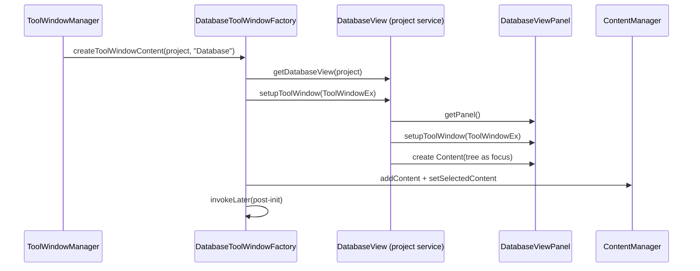
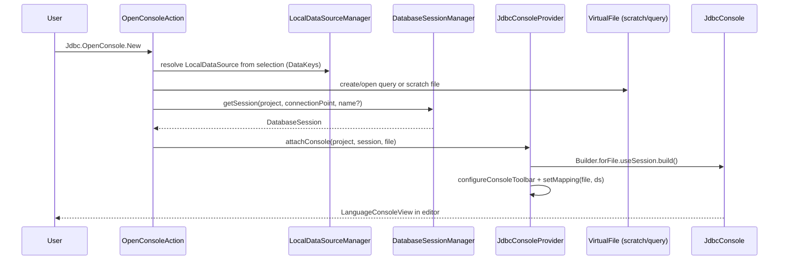
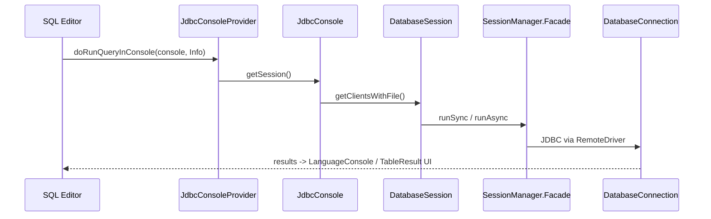

# Subsystem 4 — User Interface & Component Mapping

**Build:** DataGrip 2026.1.3 (`DB-261.24374.56`, plugin `com.intellij.database` `261.24374.56`)  
**Target:** `/Applications/DataGrip.app`  
**Focus:** Database tool window, SQL/query editors, console binding → `DatabaseSession` / `LocalDataSource` / JDBC connections  
**Method:** `META-INF/plugin.xml` (DatabaseTools + datagrip-impl), `jar tf`, `javap -public/-c` on module JARs under `plugins/DatabaseTools/lib/modules/`  
**REA MCP:** unavailable (connection error at analysis time)  
**Jar index note:** `/Users/hema/Desktop/Experiments/Grip/tmp/jar-index.txt` indexes **`Contents/lib/` only** (~364 JARs). Database UI bytecode lives primarily in **`plugins/DatabaseTools/lib/modules/intellij.database.*.jar`** — use **`tmp/jar-index-database-modules.txt`** (same `jar_basename:entry` format) for module JAR cross-ref. Module paths below remain authoritative for architecture.

**Related:** [07-core-architecture-lifecycle.md](./07-core-architecture-lifecycle.md), [02-jdbc-connections.md](./02-jdbc-connections.md), [05-database-plugin-jar.md](./05-database-plugin-jar.md), [04-datagrip-impl-jar.md](./04-datagrip-impl-jar.md)

---

## 0. Executive map — where UI lives vs descriptor shell

| Layer | Path | Role |
|-------|------|------|
| **Plugin descriptor + bundled drivers/dialects** | `Contents/plugins/DatabaseTools/lib/database-plugin.jar` | `META-INF/plugin.xml` registers tool windows, services, EPs, actions; ships `com.intellij.database.psi.DbDataSource` (API), dialect bytecode, icons |
| **Desktop DB UI (primary)** | `…/modules/intellij.database.impl.jar` (~SHA `74aa2f85…`) | Tool window factory, `DatabaseView`/`DatabaseViewPanel`, explorer actions, JDBC console UI, data-source settings UI, grid editors |
| **Core models + tree engine** | `…/modules/intellij.database.core.impl.jar` | `LocalDataSource`, `DvTree*` layered tree, `DbModelRegistry`, console core APIs |
| **Sessions + connections runtime** | `…/modules/intellij.database.connectivity.jar` | `DatabaseSession`, `DatabaseSessionManager`, `DatabaseConnectionManager`, `JdbcConsoleBase`, PSI impls (`DbDataSourceImpl`) |
| **SQL language + file types** | `…/modules/intellij.database.sql.impl.jar`, `intellij.database.sql.jar`, `intellij.database.sql.core.impl.jar` | `SqlFileType`, dialect file types, SQL editor integration |
| **Remote JDBC child JVM** | `…/modules/intellij.database.jdbcConsole.jar` | Not UI; backs session execution (see Subsystem 2) |
| **DataGrip product shell** | `Contents/plugins/datagrip-impl/lib/datagrip-impl.jar` | Overrides `ProjectView`, menus, SQL intentions, run groups — not the Database tool window core |
| **Platform Services UI** | `Contents/lib/intellij.platform.execution.serviceView.jar` | Generic “Services” tool window; DB registers `DatabaseServiceViewContributor` |

**Naming correction:** There is **no** class `DataSourcePanel` in this build (searched `DatabaseTools` tree). The explorer surface is **`DatabaseViewPanel`**; data-source configuration is **`DataSourceConfigurable`** + `com.intellij.database.dataSource.ui.*`; session list UI is **`DatabaseServiceViewContributor`** (Services view).

---

## 1. Tool window registration

### 1.1 Extension points (from `database-plugin.jar` → `META-INF/plugin.xml`)

| Tool window ID | Anchor | Factory FQCN | JAR (factory class) |
|----------------|--------|--------------|---------------------|
| **`Database`** | `right` | `com.intellij.database.DatabaseToolWindowFactory` | `intellij.database.impl.jar` |
| **`Database Changes`** | `bottom` | `com.intellij.database.pro.dataSource.srcStorage.DbSrcToolWindowFactory` | `intellij.database.pro.jar` (DbSrc / VCS-style DDL storage) |

Icons: `DatabaseIcons.ToolWindowDatabase`, `DatabaseIcons.ToolwindowDatabaseChanges` (resources in `database-plugin.jar`).

**Project service (explorer controller):**

```xml
<projectService serviceImplementation="com.intellij.database.view.DatabaseView" open="true" />
```

Registered in the same `plugin.xml`; implementation **`com.intellij.database.view.DatabaseView`** → `intellij.database.impl.jar`.

**Services tool window (sessions, not a separate `<toolWindow>` in database plugin):**

```xml
<module name="intellij.platform.execution.serviceView" />
<serviceViewContributor implementation="com.intellij.database.console.DatabaseServiceViewContributor" />
```

Platform module provides the **Services** stripe; DB plugin contributes grouped **`DatabaseSession`** / client nodes.

### 1.2 `DatabaseToolWindowFactory` — bytecode flow

**FQCN:** `com.intellij.database.DatabaseToolWindowFactory`  
**JAR:** `intellij.database.impl.jar`  
**Interfaces:** `ToolWindowFactory`, `DumbAware`

**Pseudocode (from `javap -c`):**

```text
createToolWindowContent(project, toolWindow):
  assert project, toolWindow
  toolWindow.setToHideOnEmptyContent(true)
  databaseView = DatabaseView.getDatabaseView(project)   // project service
  content = databaseView.setupToolWindow(toolWindow as ToolWindowEx)
  cm = toolWindow.getContentManager()
  cm.addContent(content)
  cm.setSelectedContent(content, true)
  Application.invokeLater { /* runnable: post-setup (lambda) */ }

init(toolWindow):
  toolWindow.setStripeShortTitleProvider(messagePointer("toolwindow.stripe.Database.shortName"))
  if PlatformUtils.isDataGrip():
    titleProvider = messagePointer("toolwindow.stripe.Database.inDataGrip")
    toolWindow.setTitle(titleProvider.get())
    toolWindow.setStripeTitleProvider(titleProvider)
```

**Sequence — first open of Database tool window:**



### 1.3 `DatabaseView.setupToolWindow` — content wiring

**FQCN:** `com.intellij.database.view.DatabaseView`  
**JAR:** `intellij.database.impl.jar`

**Pseudocode:**

```text
setupToolWindow(toolWindowEx):
  assertEventDispatchThread()
  panel = getPanel()                    // DatabaseViewPanel
  panel.setupToolWindow(toolWindowEx)   // toolbar, tree, listeners
  factory = toolWindowEx.getContentManager().getFactory()
  content = factory.createContent(panel.getComponent(), title=null, closable=false)
  content.setPreferredFocusableComponent(panel.getTree())
  return content
```

**Persistent state:** `DatabaseView` implements `PersistentStateComponent<Element>` — saves explorer options (filters, layout) across restarts.

### 1.4 `DatabaseViewPanel` — physical explorer UI

**FQCN:** `com.intellij.database.view.DatabaseViewPanel`  
**JAR:** `intellij.database.impl.jar`  
**Superclass:** `SimpleToolWindowPanel` (toolbar + main area)

| Field / API | Purpose |
|-------------|---------|
| `myToolbar` | `ActionToolbar` — `DatabaseView.*` action groups from `plugin.xml` |
| `getTree()` | `Tree` — schema/data-source explorer |
| `getAsyncModel()` | `AsyncTreeModel` — non-blocking tree updates |
| `setupToolWindow(ToolWindowEx)` | Attaches stripe actions, scroll/sync handlers |
| `uiDataSnapshot(DataSink)` | Publishes selection **`DataKey`s** to action system (see §5) |
| `selectElementFromEditor(FileEditor)` | Tree ← editor sync when auto-scroll enabled |
| `MyAutoScrollFromSourceHandler` | Toggle + handler for editor → tree |

Tree structure is **not** a naive `DefaultTreeModel` of JDBC metadata alone; it uses **`DvTreeStructure`** with layered composition (§4.2).

### 1.5 DataGrip-specific UI overrides (`datagrip-impl.jar`)

Plugin id: **`com.intellij.database.ide`**. Depends on **`com.intellij.database`**.

| Override | FQCN | Effect on UI mapping |
|----------|------|----------------------|
| Project tree | `com.intellij.database.ide.DataGripProjectView` | Replaces generic Project View — query files / consoles appear in DG-specific tree |
| Project view pane | `com.intellij.database.ide.DataGripProjectViewPane` | Pane layout for DB-first project |
| Main menu / keymap | `com.intellij.database.ide.DataGripPluginConfigurator` | Patches action groups (`PatchKeymap`) |
| SQL editor intentions | `com.intellij.database.ide.actions.DelegatingIntentionAction$*` | Maps refactor intentions to `DatabaseView.*` action IDs |
| Run/debug grouping | `com.intellij.database.ide.actions.DGRunActionGroup` | Console execute / explain cluster |

**Does not replace:** `DatabaseToolWindowFactory`, `DatabaseView`, or `JdbcConsoleProvider` — those remain in DatabaseTools modules.

---

## 2. Editor providers, file types, and “what counts as a console”

### 2.1 SQL and query file types (`plugin.xml` + SQL modules)

| File type name | FQCN | JAR (typical) | Extensions / language |
|----------------|------|---------------|------------------------|
| **SQL** | `com.intellij.sql.SqlFileType` | `intellij.database.sql.impl.jar` | `ddl;fnc;pck;…;sql;…` → language **SQL** |
| **Redis** | `com.intellij.sql.dialects.redis.RedisFileType` | sql dialect modules | `redis` |
| **CassandraQL** | `com.intellij.sql.dialects.cassandra.CassFileType` | sql dialect modules | `cql` |
| **HiveQL** | `com.intellij.sql.dialects.hive.HiveFileType` | sql dialect modules | `hql` |
| **SQLite Database** | `com.intellij.database.vfs.DbStorageFileType$SqliteStorage` | `database-plugin.jar` / core | Embedded DB files |
| **H2 Database** | `com.intellij.database.vfs.DbStorageFileType$H2Storage` | same | Embedded DB files |
| **Database Element** | `com.intellij.database.vfs.DatabaseElementFileType` | core | Virtual DDL/data elements (`das://`) |

**Product actions:** `com.intellij.database.ide.actions.NewSqlFileAction` (`datagrip-impl.jar`) creates project SQL files wired into the same PSI/file-type stack.

### 2.2 Scratch / console root (in-memory consoles)

```xml
<scratch.rootType implementation="com.intellij.database.console.DbConsoleRootType" />
```

**FQCN:** `com.intellij.database.console.DbConsoleRootType` → `intellij.database.impl.jar` (extends core `DbConsoleRootTypeCore` in `intellij.database.core.impl.jar`).

Consoles created via **Open Console** actions are scratch/query virtual files under this root, not necessarily persisted under the project directory.

### 2.3 Virtual file systems tied to DB UI

| VFS key | FQCN | Purpose |
|---------|------|---------|
| `das` | `com.intellij.database.vfs.DatabaseVirtualFileSystem` | Database element editors (DDL preview, object sources) |
| `dbSrc` | `com.intellij.database.dataSource.srcStorage.DbSrcFileSystem` | Database Changes / src storage |

### 2.4 `fileEditorProvider` — non-console DB editors

Registered in `database-plugin.jar` `plugin.xml`:

| Provider FQCN | JAR | Opens |
|---------------|-----|-------|
| `com.intellij.database.editor.ExperimentalDatabaseCompositeTableEditorProvider` | `intellij.database.impl.jar` | Data editor / composite grid |
| `com.intellij.database.editor.DasGridFileEditorProvider` | same | Table data grid |
| `com.intellij.database.editor.FragmentTableFileEditorProvider` | same | Partial table views |

These editors bind to **`das://`** (or related) virtual files and **`DbDataSource`** PSI; execution path differs from **`JdbcConsole`** but shares **`DatabaseSession`** for mutations when editing connected data.

### 2.5 Console execution provider (editor ↔ run)

**Extension point:**

```xml
<extensionPoint qualifiedName="com.intellij.database.consoleProvider"
                  interface="com.intellij.database.script.PersistenceConsoleProvider" dynamic="true" />
<database.consoleProvider implementation="com.intellij.database.console.JdbcConsoleProvider" />
```

| Class | JAR | Role |
|-------|-----|------|
| `PersistenceConsoleProvider` | `intellij.database.core.impl.jar` | API: runners for “execute in console” |
| `JdbcConsoleProvider` | `intellij.database.impl.jar` | SQL/JS execution, attach/detach console to file |
| `JdbcConsoleProviderCore` | `intellij.database.core.impl.jar` | Shared logic; `getConsole(project, file)` |

**Application service:**

```xml
<applicationService serviceInterface="com.intellij.database.console.JdbcConsoleService"
                    serviceImplementation="com.intellij.database.console.JdbcConsoleServiceImpl" />
```

`JdbcConsoleServiceImpl.getActiveConsoles(project)` — global registry of live consoles.

### 2.6 Resolving `DbDataSource` for a file

**Extension point:** `com.intellij.database.virtualFileDataSourceProvider` → `VirtualFileDataSourceProvider`

| Implementation FQCN | When it applies |
|----------------------|-----------------|
| `com.intellij.database.console.DbConsoleRootDataSourceProvider` | Scratch/console root files |
| `com.intellij.database.console.JdbcConsoleDataSourceProvider` | Query/console files with mapping |
| `com.intellij.database.dataSource.srcStorage.DbSrcDataSourceProvider` | DbSrc storage files |
| `com.intellij.database.vfs.DatabaseElementVirtualFileDataSourceProvider` | `das://` elements |
| `com.intellij.sql.database.SqlDataSourceByFileProvider` | Project SQL files (dialect / scope) |

**API (`VirtualFileDataSourceProvider`):**

```text
static findDataSource(project, file):
  for provider in EP.getExtensionList():
    ds = provider.getDataSource(project, file)
    if ds != null: return ds
  return null
```

**PSI:** Interface `com.intellij.database.psi.DbDataSource` in **`database-plugin.jar`**; runtime impl **`DbDataSourceImpl`** in **`intellij.database.connectivity.jar`**, wrapping `RawDataSource` / `LocalDataSource`.

### 2.7 Per-file data source mapping (UI dropdown in editor)

| Class | JAR | Storage |
|-------|-----|---------|
| `com.intellij.database.console.DataSourcePerFileMappings` | core/API in connectivity | Abstract mapping |
| `com.intellij.database.dataSource.DataSourcePerFileMappingsImpl` | `intellij.database.impl.jar` | Project component; `STATE_FILE_PATH` for serialized mappings |

**Key methods:**

```text
getMapping(file) -> LocalDataSource?
setMapping(file, LocalDataSource)
setMappingAsync(file, dataSource, onDone)
getAttachedFiles(dataSourceId) -> Collection<VirtualFile>
```

Used when attaching a console: **`JdbcConsoleProvider.attachConsole`** updates mappings after **`DatabaseEditorHelper.configureConsoleToolbar`**.

---

## 3. Session model — how UI holds JDBC sessions

### 3.1 Conceptual object graph

```text
DatabaseViewPanel / JdbcConsole / Actions
        │
        ├─► LocalDataSource (config entity, PersistentStateComponent)
        │         └─► DatabaseConnectionPoint (identity + options)
        │
        ├─► DatabaseSession (runtime “connection tab” / session)
        │         ├─► ConsoleRunConfiguration (VM, credentials, schema)
        │         ├─► DatabaseSessionClient[] (consumers: consoles, grids, …)
        │         └─► State (work / tx status)
        │
        └─► DatabaseConnection (physical JDBC via remote driver)
                  └─► DatabaseConnectionManager pool set
```

### 3.2 `LocalDataSource` and manager

| FQCN | JAR |
|------|-----|
| `com.intellij.database.dataSource.LocalDataSource` | `intellij.database.core.impl.jar` |
| `com.intellij.database.dataSource.LocalDataSourceManager` | `intellij.database.impl.jar` |

**Registration (`plugin.xml`):**

```xml
<database.dataSourceManager implementation="com.intellij.database.dataSource.LocalDataSourceManager" order="last" />
```

`LocalDataSourceManager.getInstance(project)` — CRUD for data sources, **`createDataSourceEditor(LocalDataSource)`** → settings UI (`DataSourceConfigurable`).

Explorer tree nodes for sources use **`com.intellij.database.view.DataSourceNode`** (`intellij.database.core.impl.jar`) inside **`DvTree*`** layers.

### 3.3 `DatabaseSession` — session handle exposed to UI

| FQCN | JAR |
|------|-----|
| `com.intellij.database.console.session.DatabaseSession` | `intellij.database.connectivity.jar` |

**Public surface (interface):**

- Identity: `getId()`, `getTitle()` / `setTitle()`, `getProject()`
- Binding: `getConnectionPoint()`, `getConfiguration()` (`ConsoleRunConfiguration`)
- Lifecycle: `isConnected()`, `getState()`, `attach`/`detach`/`exchange` (`DatabaseSessionClient`)
- Clients: `getClients()`, `getClientsWithFile()` — links consoles to session
- Topic: `DatabaseSessionStateListener` via `DatabaseSession.getTopic()`

**UI visibility:** Implements / extends visibility mixins used by Services view (`VisibleSession`, `LogViewOwner`).

### 3.4 `DatabaseSessionManager` — acquire / reuse session

| FQCN | JAR |
|------|-----|
| `com.intellij.database.console.session.DatabaseSessionManager` | `intellij.database.connectivity.jar` |

**Entry points used by UI code:**

```text
findSession(AnActionEvent) -> DatabaseSession?
getSessions(project) -> List<DatabaseSession>
getSessions(project, LocalDataSource) -> List<DatabaseSession>
getSession(project, DatabaseConnectionPoint) -> DatabaseSession
getSession(project, DatabaseConnectionPoint, sessionName) -> DatabaseSession
// Full signature includes DatabaseCredentials, strict flag, SessionType
```

**Inner `DatabaseSessionManager.Facade`** — runs work on a connection:

```text
Facade(connectionPoint, credentials, project, searchPath, …):
  connect() -> GuardedRef<DatabaseConnection>
  runSync { InterruptibleDatabaseConnection -> T }
  run / runAsync (coroutines)
  client() -> DatabaseSessionClient
  client(session) -> VisibleDatabaseSessionClient
```

Facades route through **`ConnectionsRouter` / `SingleSessionRouter` / `MultipleSessionsRouter`** (same outer class) to multiplex one JDBC connection across clients or isolate sessions.

### 3.5 `DatabaseConnectionManager` — pool of live JDBC connections

| FQCN | JAR |
|------|-----|
| `com.intellij.database.dataSource.DatabaseConnectionManager` | `intellij.database.connectivity.jar` |

**UI-relevant API:**

```text
getInstance()
build(project, connectionPoint) -> Builder
establishConnection(connectionPoint, ConsoleRunConfiguration, requestor, project, …)
getActiveConnections() -> List<DatabaseConnection>
terminateConnections(LocalDataSource, ConsoleRunConfiguration)
useDriver(project, LocalDataSource, credentials, consumer<RemoteDriver>)
```

**Not a classic Hikari pool in UI layer:** connections are **`DatabaseConnection`** instances tracked in a manager-owned set; sessions reference them via facades. Driver process pooling is **`JdbcDriverManager`** (Subsystem 2).

### 3.6 `JdbcConsole` — editor-bound session client

| FQCN | JAR |
|------|-----|
| `com.intellij.database.console.JdbcConsole` | `intellij.database.impl.jar` |
| `com.intellij.database.console.JdbcConsoleBase` | `intellij.database.connectivity.jar` |

**Key UI methods:**

```text
getSession() -> DatabaseSession
getConsoleView() -> LanguageConsoleView
getDocument() / getFile() -> PsiFile linkage
detached(DetachTrigger) — when session detaches
getActiveConsoles(project) / findConsole(event)
```

**Builder:**

```text
JdbcConsole.newConsole(project)
  .forFile(virtualFile)
  .useSession(session) | .insteadOf(oldSession)
  .fromDataSource(LocalDataSource | DasDataSource | DatabaseConnectionPoint)
  .build()
```

### 3.7 Attach console to file — full pseudocode

From `JdbcConsoleProvider` bytecode:

```text
attachConsole(project, session, file):
  if !isItPossibleToAttachConsoleTo(file) or !file.isValid(): return null
  oldConsole = getConsole(project, file)
  oldSession = oldConsole?.getSession()
  if oldConsole != null: Disposer.dispose(oldConsole)
  console = createConsole(project, session, file, oldSession)
  ChooseSchemaAction.scheduleSavedSchemaSwitch(console)
  ShowSqlParametersPanelAction.migrate(oldConsole, console)
  DatabaseEditorHelper.configureConsoleToolbar(project, console, file)
  DataSourcePerFileMappingsImpl.getInstance(project).setMapping(file, session.getConnectionPoint().getDataSource())
  updatePresentation(project, file)
  return console

findOrCreateSession(project, file):
  saved = ReadAction.compute { GlobalSessionStateListener.getSessionInfo(project, file) }
  if saved == null: return null
  dataSource = saved.getDataSource()
  sessionName = saved.getSessionName()
  if !saved.getStrict():
    return DatabaseSessionManager.getSession(project, dataSource, sessionName)
  // strict branch continues in bytecode (forces new / specific session policy)
```

**Persistence listener:**

```xml
<listener class="com.intellij.database.console.GlobalSessionStateListener"
          topic="com.intellij.database.console.session.DatabaseSessionStateListener" />
```

`GlobalSessionStateListener.getSessionInfo(project, file)` → **`SavedSession`** (data source + session name + strict flag) bridges **file reopen** → **session reuse**.

### 3.8 Services view ↔ sessions

| FQCN | JAR |
|------|-----|
| `com.intellij.database.console.DatabaseServiceViewContributor` | `intellij.database.impl.jar` |

**Behavior:**

- Implements `ServiceViewGroupingContributor<SessionContributor, PsiElement>`
- `getServices(project)` lists active session contributors
- `listenSessions()` / `refreshView(project)` sync UI on session attach/detach
- `selectNode(project, VisibleDatabaseSessionClient, …)` — focuses Services tree on running query / log
- Groups sessions under **`DbDataSource`** PSI groups

Platform **`intellij.platform.execution.serviceView.jar`** renders the tree; DB plugin only contributes descriptors and actions (e.g. **`TransactionControlAction`** nested class).

### 3.9 Session view service (auxiliary UI)

```xml
<applicationService serviceInterface="com.intellij.database.console.session.DatabaseSessionViewService"
                    serviceImplementation="com.intellij.database.console.session.DatabaseSessionViewServiceImpl" />
```

Used for session-scoped UI state (session tab titles, view coordination) — implementation in **`intellij.database.impl.jar`**.

---

## 4. Explorer tree architecture (Database tool window content)

### 4.1 Controller stack

```text
DatabaseView (service)
  └─ DatabaseViewPanel
       └─ Tree + AsyncTreeModel
            └─ DvTreeStructure (implements AbstractTreeStructure)
                 └─ DvTreeLayerDef stack (Fundament → … → Presentation)
```

### 4.2 Layer classes (FQCN → JAR: `intellij.database.core.impl.jar`)

| Layer class | Role |
|-------------|------|
| `DvTreeFundamentLayer` | Root physical structure |
| `DvTreeRootLayer` | Global root folder |
| `DvTreeForestLayer` | User folders (`DvForestAction*`) |
| `DvTreeDsFoldersLayer` | Data source grouping |
| `DvTreeModelLayer` | Schema objects from **`DbModelRegistry`** |
| `DvTreeFilesLayer` | Query files / console files in tree |
| `DvTreeLayoutLayer` | Layout groups (schemas, categories) |
| `DvTreeTransformLayer` | DBMS-specific tree shaping |
| `DvTreeCacheLayer` | Caching / lazy child counts |
| `DvTreePresentationLayer` | Text/icons |
| `DvTreeStructureService` | Listeners: data sources, VFS, query files, storage |

**Model registry:** `com.intellij.database.DbModelRegistry` — connects introspected **`DasObject`** graph to tree nodes.

**Options:** `DvViewOptions` / `DvMutableViewOptions` exposed via `DatabaseView.getViewOptions()`.

### 4.3 Introspection UI hooks

Action group **`DatabaseView.SetIntrospectionLevelActions`** → classes under `com.intellij.database.view.introspection.*` (`intellij.database.impl.jar`).

---

## 5. Action system and tree ↔ editor selection sync

### 5.1 `DataKey` contract (tree selection → actions)

**Source:** `com.intellij.database.view.DatabaseView` (`intellij.database.impl.jar`)

| DataKey | Type (erased) | Used by |
|---------|---------------|---------|
| `DATABASE_VIEW_KEY` | `DatabaseView` | Global database context |
| `DATABASE_NODES` | `BasicNode[]` | Tree selection |
| `DATABASE_ELEMENTS` | `BasicElement[]` | Model selection |
| `DATABASE_NODE_RANKS` | `EnumSet<DvTreeNodeRank>` | Node kind filtering |
| `DATABASE_RELATED_SINGLE_DATA_SOURCE` | `DataSourceNode` | Single-DS context |
| `DATABASE_RELATED_DATA_SOURCES` | `DataSourceNode[]` | Multi-DS context |
| `DATABASE_TREE_IS_ORIGIN` | `Boolean` | DnD / copy semantics |
| `DB_ELEMENTS` | `DbElement[]` | PSI-level selection |
| `DROP_ELEMENT_PROVIDER` | `DeleteProvider` | Safe delete |

**Panel-level:** `DatabaseViewPanel.uiDataSnapshot(DataSink)` publishes keys when tree selection changes → enables **`DatabaseView.Refresh`**, **`Jdbc.OpenConsole.*`**, DDL actions, etc.

**Action update thread:** Many DB actions use **`ActionUpdateThread.BGT`** (e.g. `ScrollFromEditorAction`).

### 5.2 Major action groups (from `plugin.xml`)

| Group ID | Class | Purpose |
|----------|-------|---------|
| `DatabaseView.NewGroup` | `DatabaseViewActions$NewGroup` | New console / DDL / data source |
| `DatabaseView.AddActionGroup` | nested | Add DS, driver, folder |
| `DatabaseView.Tools` | `DatabaseViewActions$ToolsPopupGroup` | Schema manager, FTS, submit/revert |
| `DatabaseView.Clipboard` | `DatabaseClipboardGroup` | Copy/cut/paste DS tree |
| `DatabaseView.Diagnostics` | `DatabaseViewActions$DiagnosticsGroup` | Internal model dumps |
| `DatabaseView.DGRunGroup` | `DGRunActionGroup` (datagrip-impl) | Execute/explain in editor |

**Representative action FQCNs (`intellij.database.impl.jar` unless noted):**

| Action ID | Class |
|-----------|-------|
| `DatabaseView.Refresh` | `com.intellij.database.actions.RefreshModelAction` |
| `DatabaseView.PropertiesAction` | `com.intellij.database.actions.ManageDataSourcesAction` |
| `Jdbc.OpenConsole.Any` | `com.intellij.database.actions.OpenConsoleAction` |
| `Jdbc.OpenConsole.New` | `OpenConsoleAction$CreateNew` |
| `Jdbc.OpenConsole.Scratch` | `OpenConsoleAction$CreateScratch` |
| `Console.Jdbc.Execute` | (run module — wired via console toolbar) |
| `DatabaseView.ScrollFromEditor` | `com.intellij.database.view.ScrollFromEditorAction` |

### 5.3 Select in Database View (structure sync)

| FQCN | JAR |
|------|-----|
| `com.intellij.database.view.SelectInDatabaseView` | `intellij.database.impl.jar` |

**API:**

```text
getToolWindowId() -> "Database"
canSelect(SelectInContext) / selectIn(context, requestFocus)
selectIn(context, focus, wait) -> Promise<Void>
static askProviders(context) -> DbElement  // EP SelectInDatabaseView.Extension
```

**Extension point:** `com.intellij.database.selectInProvider` → `SelectInDatabaseView.Extension` for DBMS-specific resolve from editor caret to tree node.

**Editor provider:** `com.intellij.database.editor.DbElementSelectInProvider` — links data editors to select-in.

### 5.4 Auto-scroll from editor (`ScrollFromEditorAction`)

**Pseudocode:**

```text
update(event):
  handler = event.getData(DatabaseViewPanel.AUTO_SCROLL_HANDLER)
  enabled = handler != null && !handler.isAutoScrollEnabled()
  presentation.setEnabledAndVisible(enabled)

actionPerformed(event):
  project = event.getProject() ?: return
  handler = event.getData(AUTO_SCROLL_HANDLER) ?: return
  editor = FileEditorManagerEx.getInstanceEx(project).currentWindow?.selectedComposite?.fileEditor ?: return
  handler.scrollFromEditor(editor)  // delegates to panel.selectElementFromEditor
```

Inverse direction (tree → editor): navigation actions (`Jdbc.OpenEditor.Data`, `Console.TableResult.NavigateAction`) open **`das://`** or query files and use **`DatabaseView.select*`** promises.

### 5.5 `DatabaseView.select*` APIs (programmatic sync)

```text
selectNode(BasicNode) -> Promise<Void>
selectElement(Object) -> Promise<Void>
select(PsiElement, focus) -> Promise<Void>
select(project, collection, focus, wait) -> Promise<Void>
refreshViewNicely(project) / refreshViewAndSelect(project, nodes)
```

Used by introspection, Open Console, and **Services** view (`DatabaseServiceViewContributor.selectNode`).

---

## 6. End-to-end data flows

### 6.1 Open SQL console from Database tool window



### 6.2 Execute statement in attached console



### 6.3 Data source settings dialog (not explorer panel)

```text
ManageDataSourcesAction / DatabaseView.PropertiesAction
  -> LocalDataSourceManager.createDataSourceEditor(LocalDataSource)
       -> DataSourceConfigurable (extends AbstractDataSourceConfigurable)
            -> com.intellij.database.dataSource.ui.* panels
                 (AuthWidgetBuilderImpl, BeforeConnectionStepsPanel,
                  DataSourceTestConnectionManager, DbOptionsEditor, …)
```

Test connection uses **`DataSourceTestConnectionManager.performTestConnection`** → temporary **`DatabaseSessionManager.Facade`** / ping path (same connectivity stack as runtime sessions).

---

## 7. Master table — critical FQCN → JAR

| FQCN | JAR under `DatabaseTools/lib/modules/` or plugin |
|------|--------------------------------------------------|
| `com.intellij.database.DatabaseToolWindowFactory` | `intellij.database.impl.jar` |
| `com.intellij.database.view.DatabaseView` | `intellij.database.impl.jar` |
| `com.intellij.database.view.DatabaseViewPanel` | `intellij.database.impl.jar` |
| `com.intellij.database.view.DataSourceNode` | `intellij.database.core.impl.jar` |
| `com.intellij.database.explorer.structure.DvTreeStructure` | `intellij.database.core.impl.jar` |
| `com.intellij.database.DbModelRegistry` | `intellij.database.core.impl.jar` |
| `com.intellij.database.dataSource.LocalDataSource` | `intellij.database.core.impl.jar` |
| `com.intellij.database.dataSource.LocalDataSourceManager` | `intellij.database.impl.jar` |
| `com.intellij.database.dataSource.DataSourceConfigurable` | `intellij.database.impl.jar` |
| `com.intellij.database.dataSource.DataSourcePerFileMappingsImpl` | `intellij.database.impl.jar` |
| `com.intellij.database.console.JdbcConsoleProvider` | `intellij.database.impl.jar` |
| `com.intellij.database.console.JdbcConsole` | `intellij.database.impl.jar` |
| `com.intellij.database.console.JdbcConsoleServiceImpl` | `intellij.database.impl.jar` |
| `com.intellij.database.console.DatabaseServiceViewContributor` | `intellij.database.impl.jar` |
| `com.intellij.database.console.session.DatabaseSession` | `intellij.database.connectivity.jar` |
| `com.intellij.database.console.session.DatabaseSessionManager` | `intellij.database.connectivity.jar` |
| `com.intellij.database.dataSource.DatabaseConnectionManager` | `intellij.database.connectivity.jar` |
| `com.intellij.database.psi.DbDataSource` (interface) | `database-plugin.jar` |
| `com.intellij.database.psi.DbDataSourceImpl` | `intellij.database.connectivity.jar` |
| `com.intellij.sql.SqlFileType` | `intellij.database.sql.impl.jar` |
| `com.intellij.database.ide.DataGripProjectView` | `datagrip-impl.jar` |
| `com.intellij.database.pro.dataSource.srcStorage.DbSrcToolWindowFactory` | `intellij.database.pro.jar` |

**SHA-256 (representative):**

| JAR | SHA-256 |
|-----|---------|
| `database-plugin.jar` | `2e646602c19d2add009f9333425b8cba05f2756d2c249936d6e43870dd2090da` |
| `intellij.database.impl.jar` | `74aa2f8531256ffcec3c37338aa8c3fd7b52cc04653c6fe1051828d55d2c96d8` |
| `intellij.database.core.impl.jar` | `9688928aa5ac341d4256814c7f6e1ea4a4a689515e121ffb4050451dd2a69e10` |
| `intellij.database.connectivity.jar` | `2cd912e49c6726f154c9b479433630fade0ecfc9e551267e240688b31355fd7b` |
| `intellij.database.sql.impl.jar` | `b0003de03f85058b2bc9662724857254591518585e06862da5eb6a831a373de1` |
| `datagrip-impl.jar` | `e74f78a180b459dfcca507cfa36fe97a1a6e4e1cd384e3bc70a7600c6d8b0589` |

---

## 8. Evidence limits & suggested follow-ups

| Gap | Mitigation |
|-----|------------|
| REA decompile unavailable | Used `javap -c` on hot paths; full Vineflower on `DatabaseViewPanel` / `OpenConsoleAction` would recover local variable names |
| `jar-index.txt` skips plugin modules | Use `tmp/jar-index-database-modules.txt` for `plugins/DatabaseTools/lib/modules/*.jar` cross-ref |
| Runtime validation | Frida/JDBC trace on `DatabaseSessionManager.getSession` while opening console (Subsystem 2 tooling) |
| Frontend split | `intellij.database.frontend.split.jar` registers **`FakeFrontendJdbcConsoleService`** when running remote frontend — desktop paths above use **`JdbcConsoleServiceImpl`** |

---

## 9. Mental model (single paragraph)

The **Database** tool window is a **`Content`** wrapping **`DatabaseViewPanel`**, backed by project service **`DatabaseView`** and a layered **`DvTreeStructure`** over **`DbModelRegistry`** and **`LocalDataSourceManager`**. SQL consoles and query files are normal editor tabs whose **`VirtualFile`** is mapped to a **`LocalDataSource`** via **`VirtualFileDataSourceProvider`** + **`DataSourcePerFileMappingsImpl`**, and to a live **`DatabaseSession`** via **`JdbcConsoleProvider.attachConsole`** / **`GlobalSessionStateListener`**. Execution flows from editor actions into **`JdbcConsole.getSession()`**, then **`DatabaseSessionManager.Facade`** onto **`DatabaseConnectionManager`**’s JDBC connections. Parallel visibility into sessions is provided by **`DatabaseServiceViewContributor`** in the platform **Services** tool window. DataGrip-specific **`datagrip-impl`** adjusts Project View and editor action groups but leaves this session/tree/console core intact.
