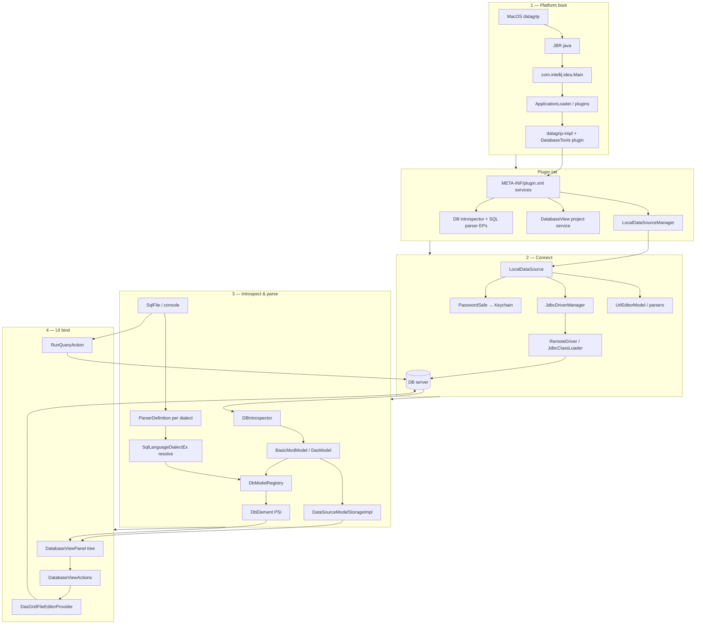

# Architecture synthesis — DataGrip static audit (cross-subsystem)

**Build:** DataGrip 2026.1.3 (`DB-261.24374.56`)  
**Bundle:** `/Applications/DataGrip.app`  
**Date:** 2026-10-15  

This document ties **Subsystem 1–4** reports into one launch-to-UI narrative. Inventory-only reports (`01`–`06`) remain reference material for bundle layout and JAR hashes.

---

## Subsystem index (architecture audit)

| # | Report | Focus |
|---|--------|--------|
| 1 | [07-core-architecture-lifecycle.md](./07-core-architecture-lifecycle.md) | Native launcher → JVM → `ApplicationLoader`, plugin/module graph, `ComponentManager` |
| 2 | [02-jdbc-connections.md](./02-jdbc-connections.md) | Drivers, remote JDBC child JVM, URL editors, `PasswordSafe` / Keychain |
| 3 | [08-query-parsing-introspection.md](./08-query-parsing-introspection.md) | `DBIntrospector`, SQL PSI/dialects, `DbModelRegistry`, model persistence |
| 4 | [09-ui-component-mapping.md](./09-ui-component-mapping.md) | `DatabaseView`, grids, consoles, `datagrip-impl` shell overrides |

**Supporting inventory:** [00-overview.md](./00-overview.md), [01-app-inventory.md](./01-app-inventory.md), [02-native-launcher.md](./02-native-launcher.md), [03-info-plist.md](./03-info-plist.md), [04-datagrip-impl-jar.md](./04-datagrip-impl-jar.md), [05-database-plugin-jar.md](./05-database-plugin-jar.md), [06-jdbc-connection-contents-lib.md](./06-jdbc-connection-contents-lib.md).

---

## End-to-end data flow (static model)



---

## Phase notes (what crosses subsystem boundaries)

### Launch → plugin init (Subsystem 1 → all)

1. Native launcher builds **203-JAR** boot classpath from `product-info.json` ([07](./07-core-architecture-lifecycle.md)).
2. `-Didea.platform.prefix=DataGrip` selects product resources; **DatabaseTools** loads as a plugin with **50+ nested module JARs**.
3. `DataGripPluginConfigurator` ([09](./09-ui-component-mapping.md)) patches UI; core DB services register from `database-plugin.xml`.

### Datasource connect (Subsystem 2 → 3)

1. User commits URL via **template/stateless parsers** → `LocalDataSource` ([02](./02-jdbc-connections.md)).
2. **Credentials** never land in `dataSources.xml`; `PasswordSafe` fills `Properties` at connect time.
3. **Remote JDBC JVM** loads vendor `Driver`; IDE holds RMI stub — same connection object **`DBIntrospector.attachToDB`** expects ([08](./08-query-parsing-introspection.md)).

### Parse / introspect (Subsystem 3 internal + 2)

1. **Introspection** is EP-driven per `Dbms`: JDBC metadata wrappers + optional `JdbcSourceLoader`.
2. Output model is **cached separately** from connection XML; loader publishes `DatabaseModelLoader` topic.
3. **SQL files** pick `Language` from data source; resolve imports **`TreePattern`** against introspected schema via `DbDataSourceImpl.getModel()`.

### UI bind (Subsystem 3 → 4)

1. `DatabaseView` listens for model refresh → **`AsyncTreeModel`** rebuild under `DataSourceNode`.
2. Selection exposes both **`BasicElement`** and **`DbElement`** via `DataKey`s for actions.
3. Double-click / Open → **grid editor** or **console** → re-enters connect pipeline for queries.

---

## Critical singletons (by project)

| Service | Subsystem | Consumed by |
|---------|-----------|-------------|
| `LocalDataSourceManager` | 2 | Tree roots, settings, connect |
| `DatabaseConnectionManager` | 2 | Introspection, grid, console |
| `DatabaseView` | 4 | All schema UI |
| `DbModelRegistry` | 3 | PSI, resolve, navigation |
| `DbModelRegistry` / model storage | 3 | Persistence across restarts |

---

## Security & trust boundaries (merged)

| Boundary | Mechanism | Report |
|----------|-----------|--------|
| Driver bytecode | Isolated child JVM + `JdbcClassLoader` | 02 |
| Secrets | Keychain / AES credential store | 02, 06 |
| Schema cache | Local project/system files (no passwords) | 08 |
| SQL execution | Console read-only PSI policy + credentials on connect | 08, 09 |

---

## Dynamic validation (Phase 2)

- **2a** live JDBC/RMI: **[11-dynamic-validation.md](./11-dynamic-validation.md)**
- **2b** remaining items: **[12-dynamic-validation-2b.md](./12-dynamic-validation-2b.md)** — bytecode path `SqlResolveInspection` → `RunIntrospection` → `DataSourceSyncManager.tryPerformSync`; PasswordSafe service-name `IntelliJ Platform DB — <uuid>`; UI/Frida recipes

Re-run smoke: `scripts/validate-dynamic.sh all` (unsandboxed).

Still **user-interactive** (need Refresh / Alt-Enter / Select In; debug log categories):

1. **Full schema sync** INFO/DEBUG trace on fresh Refresh (cache on disk already proves prior sync).
2. **Resolve quick-fix** runtime hit (chain proven in bytecode).
3. **UI** — live `DatabaseView.select(PsiElement)` / Select In.

---

## Document map (quick links)

```text
10-architecture-synthesis.md  ← you are here
├── 07-core-architecture-lifecycle.md
├── 02-jdbc-connections.md
├── 08-query-parsing-introspection.md
└── 09-ui-component-mapping.md
```

---

## Class-path indexes (static RE)

| File | Scope |
|------|--------|
| [`tmp/jar-index.txt`](../tmp/jar-index.txt) | `Contents/lib/` (~364 JARs) — platform bootstrap, lifecycle |
| [`tmp/jar-index-database-modules.txt`](../tmp/jar-index-database-modules.txt) | `plugins/DatabaseTools/lib/modules/` (51 JARs) — SQL, introspection, UI session classes |

Same `jar_basename:entry` format as `jar-index.txt` (module index added 2026-10-15).

---

*Synthesis complete for architecture audit Subsystems 1–4.*
